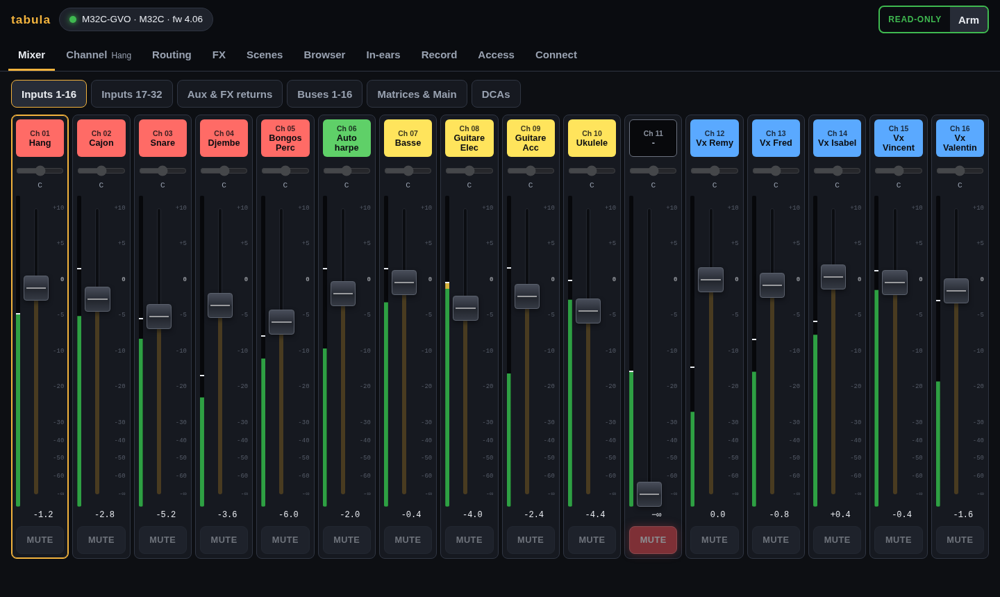
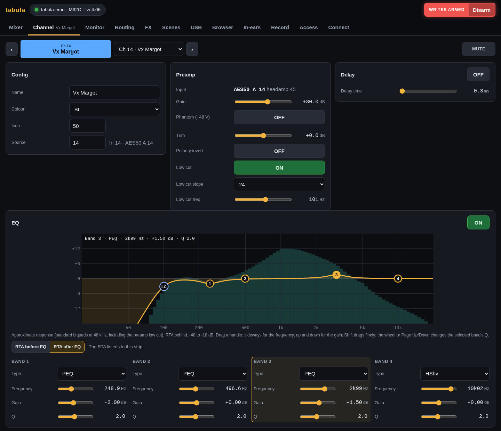
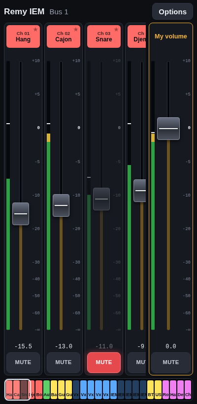
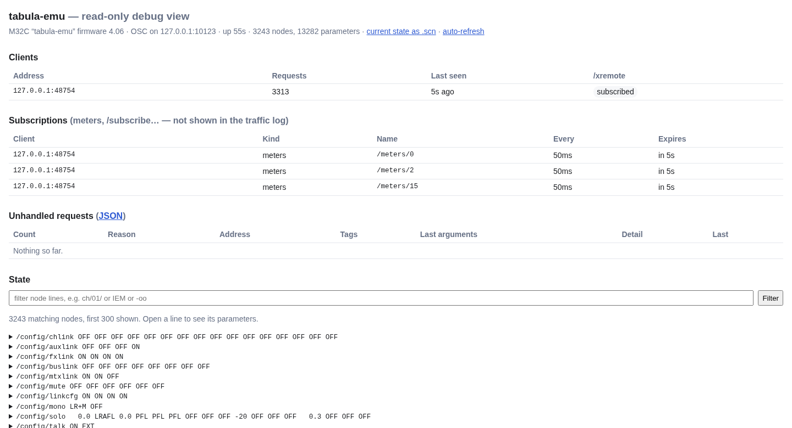

# tabula

[](https://github.com/yoda-jm/tabula/actions/workflows/ci.yml)
· [Site](https://yoda-jm.github.io/tabula/) · [Releases](https://github.com/yoda-jm/tabula/releases)

Tools for Behringer X32 / Midas M32 digital consoles, in Go.

- **`tabula-emu`** — a console emulator speaking the console's OSC protocol
  (UDP 10023), to develop and test without a console. M32-Edit connects to
  it, and a user reports X32-Mix's faders working; X32-Edit and Mixing
  Station speak the same protocol but have not been tried yet. A read-only
  HTTP page shows what it stores and every request it did not understand.
- **`tabula`** — a client that connects to a console or to the emulator and
  serves a web GUI to the laptop at the desk and to the band's phones:
  mixer, meters, channel details with headamps and a draggable EQ, routing
  with a patchbay, effects with a graphic EQ and RTA, scenes, safes and
  scene files, the console's USB stick, every parameter. For the show: a
  pre-show check, a patch list PDF for the venue's engineer, in-ear mixes
  on the musicians' phones, and recording and replay with the audio tracks
  of the console's USB card, markers and a setlist, audio that recovers by
  itself mid-show (see [recording](docs/recording.md)). Read-only until you
  arm writes; undo takes back the last changes.

See [how the emulator simulates the console](docs/emulator.md) (audio flow,
meters, RTA, effects, linked strips), [the pages of the GUI](docs/gui.md) and
[docs/PLAN.md](docs/PLAN.md) for the roadmap.

## Screenshots

**tabula**, the mixer of a show, with the names and colours of the console:



A channel, with its EQ curve and the RTA behind it, and a musician's in-ear
mix on a phone:

<p>


</p>

**tabula-emu**, its debug page: the connected clients and their meter
subscriptions, the requests it did not understand, and every parameter:



## Status

Pre-release: [v0.3.0](https://github.com/yoda-jm/tabula/releases/tag/v0.3.0)
(13 November 2026), what changed in the [changelog](CHANGELOG.md). The
parameter schema covers every node of a scene file and round-trips real
scenes byte for byte. Much of what tabula does to a console (writes, the
USB card's audio, the USB stick) has been checked against the emulator more
than against a real M32: try it before a show depends on it.

## Download

The current release, [v0.3.0](https://github.com/yoda-jm/tabula/releases/tag/v0.3.0),
has the same archives. Latest build of `main` (both programs, GUI included):
[Linux x86-64](https://github.com/yoda-jm/tabula/releases/download/latest/tabula-linux-amd64.tar.gz) ·
[Linux ARM64](https://github.com/yoda-jm/tabula/releases/download/latest/tabula-linux-arm64.tar.gz) ·
[Linux ARM](https://github.com/yoda-jm/tabula/releases/download/latest/tabula-linux-arm.tar.gz) ·
[macOS Apple silicon](https://github.com/yoda-jm/tabula/releases/download/latest/tabula-darwin-arm64.tar.gz) ·
[macOS Intel](https://github.com/yoda-jm/tabula/releases/download/latest/tabula-darwin-amd64.tar.gz) ·
[Windows](https://github.com/yoda-jm/tabula/releases/download/latest/tabula-windows-amd64.zip).
Versioned releases: [releases page](https://github.com/yoda-jm/tabula/releases).
Recording the audio tracks on macOS or Windows also needs
[ffmpeg](https://ffmpeg.org/download.html), next to `tabula` or on the PATH
(see [Download](https://yoda-jm.github.io/tabula/#download)).

## Quick start

```sh
go run ./cmd/tabula-emu -scene testdata/scenes/demo.scn -http :8032
```

Then point M32-Edit (or another remote app) at this machine's IP and open
<http://localhost:8032> to see the state, the traffic and every request the
emulator did not handle. `testdata/scenes/demo.scn` is a real show with
made-up names. To have your own scenes in the console's scene slots, copy
them into `var/library` (git ignores `var/`) as `scene-00.scn`,
`scene-01.scn`… and add `-library var/library`. `-usb testdata/usb` puts a
USB stick in it, whose WAV files the console's player plays (silently).

To drive it (or a real console) from a browser:

```sh
make build                      # GUI (needs Node 22) + binaries in bin/
./bin/tabula -console 127.0.0.1 # or the console's IP; -http :8033 to reach it from a phone
```

and open <http://localhost:8033>. tabula starts **read-only**: arm writes
(top right) to move faders on the console.

## Build

```sh
make build   # cd web && npm ci && npm run build, then go build -o bin/ ./cmd/...
make test    # go test ./... and the GUI tests (they run go run ./web/fixture: every page is rendered from the demo show)
make dev     # emulator + tabula + Vite dev server with hot reload (http://localhost:5173)
```

The GUI lives in `web/` (React, TypeScript, Vite) and is embedded in the
`tabula` binary; a plain `go build` without it serves a page saying so.
`tabula -web-dir web/dist` serves the GUI from that folder instead of the
one built in (a GUI just rebuilt, without rebuilding tabula).

## Name

*Tabula* is Latin for board or table — a mixing desk is a *table de mixage*.
