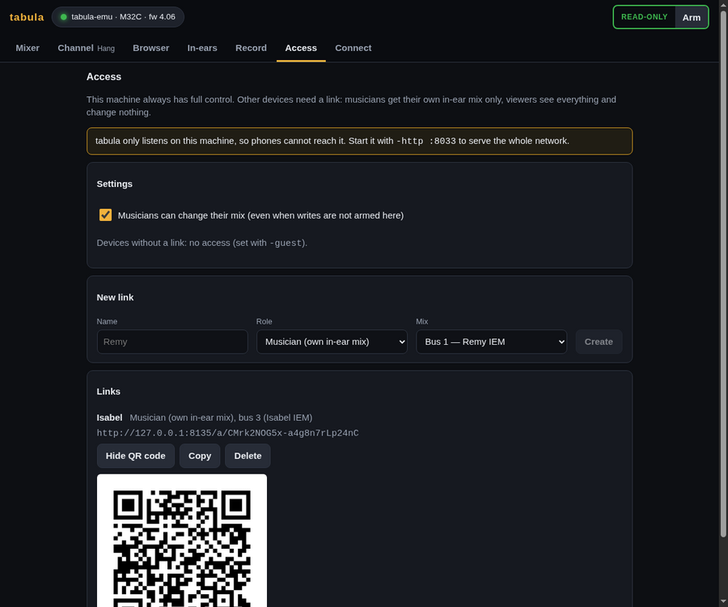
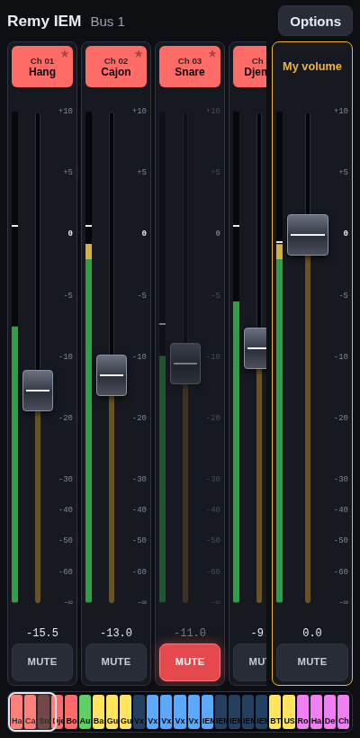
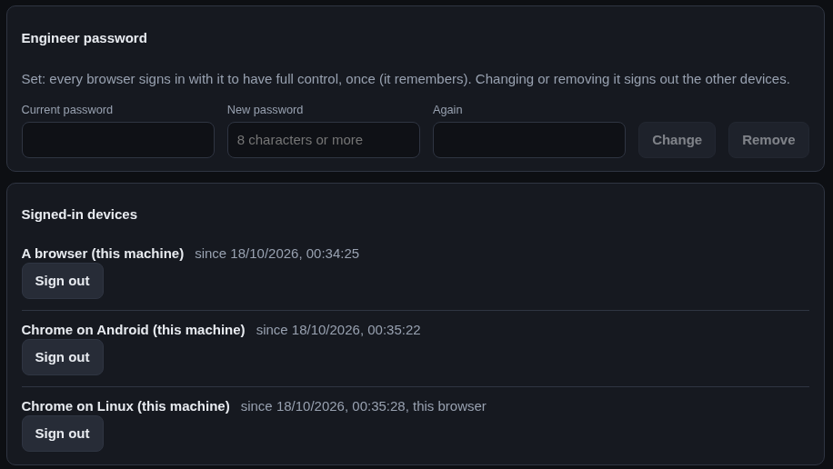
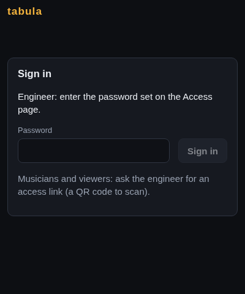

# Access: in-ear mixes for musicians, viewers

One `tabula` serves every device of the band at once. Each device gets a
role:

| Role | Sees | Changes |
|---|---|---|
| **engineer** | everything | everything (once writes are armed) |
| **musician** | their in-ear mix | the sends to their bus from every channel, aux input and FX return, and their bus volume and mute |
| **viewer** | everything | nothing |
| none | a "no access" page (or the sign-in page) | nothing |

The machine running `tabula` is the engineer, unless an
[engineer password](#engineer-password) is set: then every browser signs in
with it, that machine included. Other devices get their role from an
**access link** the engineer makes for them; without one they get the guest
role, none by default (`-guest viewer` lets anyone on the network watch,
`-guest engineer` gives everyone full control as before).

## At a gig

1. Start `tabula` so the whole network can reach it, connected to the
   console:

   ```sh
   tabula -http :8033 -console 192.168.1.62
   ```

2. On the **Access** page, make a link for each musician: their name and
   the bus of their in-ear mix (the list shows the bus names from the
   console). Viewers and a second engineer device (a tablet at front of
   house) get links of their role.
3. Show the link's **QR code**: the musician scans it with their phone,
   which opens their mix. The phone remembers the access (a cookie); the
   musician does not need the link again.



Links are made of the address of this machine and a secret: when the
laptop has several addresses (Wi-Fi and Ethernet), pick the one the phones
use in **Links use**.

## The musician's page



- **My volume** and the ON/OFF button are the fader and mute of their bus,
  with its meter.
- Then one row per source: name and colour as on the console, its level, the
  send level to their bus and the send's ON/OFF. Sources without a name are
  hidden (**Show unnamed sources** shows them).
- **★** pins a source to the top (their own voice, the bass…), remembered on
  the phone.
- A stereo in-ear mix (two linked buses) has a pan slider per source; the
  musician changes the odd bus and the console moves the other one.
- **Keep the screen on** works when the browser allows it, which needs
  HTTPS: over plain HTTP on the local network, set the phone's screen timeout
  instead.
- **Leave** forgets the access on that phone.

Musicians change their mix **even when writes are not armed** on the
engineer's side, as long as **Musicians can change their mix** is on (the
default) on the Access page. Turning it off makes every musician page
read-only at once. The engineer can see any mix as its musician does on the
**In-ears** page.

A musician cannot change anything else: not the send taps (pre/post), not
another musician's mix, not the channels themselves. `tabula` checks every
write, so this holds for anything talking to its API, not only its pages.

## Managing links

- **Delete** ends an access at once: the pages opened with it stop and show
  "no access".
- Accesses are kept in `access.json` (or the file given with `-access`),
  readable by its owner only since it holds the secrets.
- Changes made through a link are recorded with its name (`web Remy`) in
  [recorded sessions](index.md), so a replay shows who moved what.

## Engineer password

Without a password, whoever uses the machine running `tabula` has full
control. Set one in **Engineer password** on the Access page (8 characters
or more) and every browser has to sign in with it to be the engineer, the
machine itself included; a browser stays signed in (a cookie) until it
signs out.



- A browser without access shows the sign-in page: the engineer types the
  password there. Musicians and viewers still use their links, which work
  as before (and so do engineer links).

  

- Setting the password signs in the browser that sets it, so the engineer
  is not locked out.
- **Signed-in devices** lists the browsers signed in with the password
  (named after the browser, its system and its address); **Sign out** ends
  one at once, its pages included. **Sign out** in the top bar ends the
  session of this browser.
- Changing the password (it needs the current one) or removing it signs out
  every other device.
- Wrong passwords are slowed down: after 5 in a row a device waits 30
  seconds, then twice as long after each further one.
- The password is kept as a salted hash (PBKDF2-SHA256) in `access.json`,
  never in clear.
- **Lost it?** Stop `tabula` and run `tabula -reset-password` (with the same
  `-access` file if you use one): the password and the signed-in devices are
  removed, the links are kept, and the machine is the engineer again.
- A password and `-guest engineer` (everyone is the engineer) do not go
  together: `tabula` refuses to start with both, and the Access page does
  not offer the password then.

## Security

`tabula` uses plain HTTP on the local network. Anyone holding a link, or
able to read the network traffic, has that access (the password included,
when signing in from another device); delete a link to revoke it. Without
an engineer password, every request from the machine itself is the
engineer's: anyone at the laptop has full control, and behind a reverse
proxy on that machine (to add HTTPS, say) **every** request comes from the
machine itself, so every device would be the engineer: set a password
then. In any case, do not expose `tabula` beyond the band's network (no port
forwarding). An engineer link or a session from another device controls
the console and the recordings but cannot make `tabula` run a program of
its choice: a custom audio recorder command is only accepted from the
engineer on the machine itself (signed in there when a password is set;
behind a reverse proxy, from any engineer).

See the [HTTP API](API.md#access) for the endpoints.
