# The tabula GUI

`tabula` serves its GUI on its HTTP port (<http://localhost:8033> by
default; start it with `-http :8033` to reach it from a phone or a tablet).
Every page works on a phone as well as on a laptop. Any number of browsers
can be open at once: they share the one console connection, and a change
made in one shows in the others.

**Read-only until armed.** Controls are greyed out until you arm writes
(top right), after a confirmation. On a real console nothing moves by
accident. Disarm to go back to read-only.

**On a weak network.** When the page loses `tabula` (Wi-Fi gone, laptop
asleep), a red bar says *Connection lost — reconnecting…* on every page and
the meters go blank rather than freeze; the page reconnects by itself and
loads the console again. A connection that went silent without breaking
(a phone changing access point) is noticed within 15 s. A change that
`tabula` refuses or does not answer within a few seconds goes back to the
console's value, with a message: what a control shows is what the console
has.

**Who sees what.** The machine running `tabula` is the engineer and sees
every page (once signed in, when an engineer password is set). Other
devices get a role from an access link: viewers see the
Mixer, Channel and Browser pages read-only; musicians only get their in-ear
mix. Monitor, Routing, FX, Scenes, USB, In-ears, Record, Access and Connect
are engineer pages. See [access](access.md).

## Mixer

Banks of strips, as on the console: inputs 1-16 and 17-32, aux inputs and
FX returns, buses, matrices and mains, DCAs. Each strip has its scribble
strip (name and colour), meter, fader, solo, mute and pan. Tap a scribble
strip to select it for the Channel page. Names of two words take two lines
(`Guitare Elec`), so the 12 characters the console allows show in full.

Next to the banks, the console's six **mute groups** (red when on) and
**Clear solo**, which says how many strips are soloed. A strip that a mute
group or a muted DCA silences, though its own mute is off, shows a hatched
MUTE: its tooltip says what silences it (*mute group 2*, *DCA 3*). SOLO
works as on the console: what is soloed goes to the monitor and the
headphones only (the [Monitor](#monitor) page sets how).

On a phone, the banks scroll sideways:

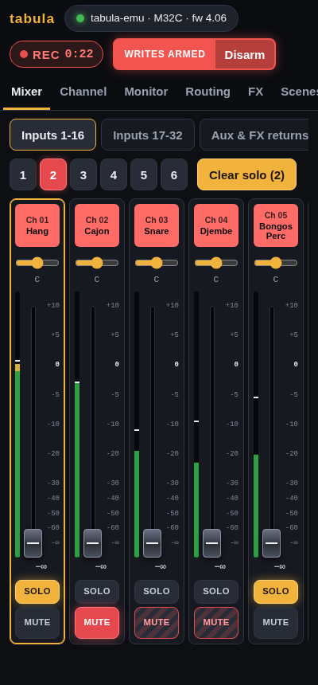

**Linked pairs** (`/config/chlink`, `auxlink`, `fxlink`, `buslink`,
`mtxlink`) show as one stereo strip, `Mtx 1-2` or `FX 1`, with the meters of
both sides, when their faders and mutes follow each other (the link option
`/config/linkcfg/fdrmute`). Its fader and mute write to the odd strip, and
the console moves the even one with it, as it does for a linked pair on
its surface; pans stay per strip, on the Channel page. With the fader and
mute option off, the two strips stay separate. The Channel page of a linked
strip says which strip it is linked with.

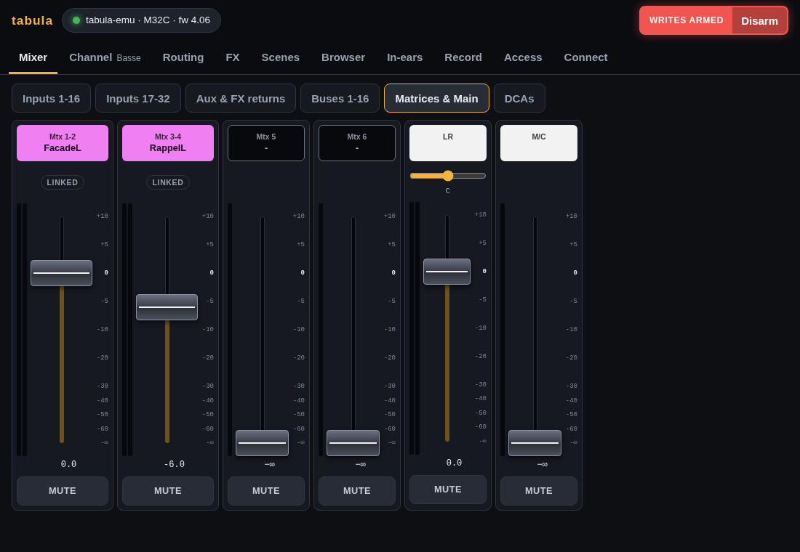

## Channel

Everything about one strip: configuration, preamp and delay, the EQ with
its response curve, gate, dynamics, insert, main mix, sends with the bus
names, DCA and mute groups, automix. Only the sections the strip has are
shown. The EQ comes right after the preamp, so its curve is on screen when
the page opens; the other sections fill balanced columns.

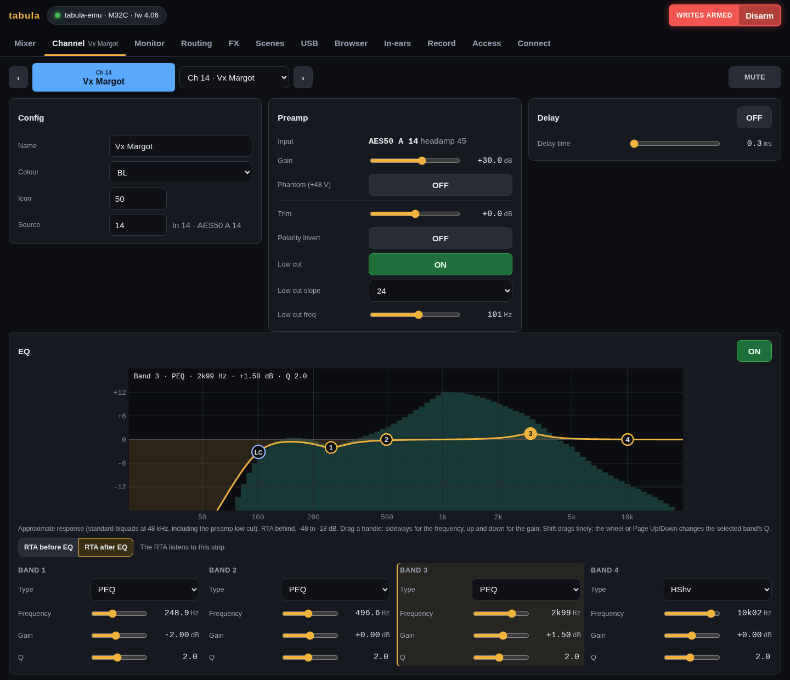

**EQ curve.** Each band has a numbered handle on the curve: drag it
sideways for its frequency, up and down for its gain (the cuts and the
crossover types have no gain: they only move sideways). A drag is relative,
so touching a handle a little off never makes the band jump; Shift drags
finely. The handle selected is filled, its band's fields below are
highlighted, and its values are written at the top left of the curve; the
mouse wheel over it, or Page Up/Down, changes its Q (Q is in the band's
fields too, for a phone). A focused handle also moves with the arrow keys
(Shift: by the smallest step). When the preamp low cut is on, the **LC**
handle moves its frequency. A gain band's handle sits at its frequency and
gain; the others sit on the curve. The curve shows ±18 dB: what goes
further, such as the slope of a low cut, runs out of the drawing. On a
phone the drawing is taller, so the handles stay big enough to drag, and a
touch on a handle drags it instead of scrolling the page. Writes must be
armed (or the in-ear access must cover the strip).

**RTA.** When the console's RTA listens to the strip, its spectrum is
drawn behind the EQ curve. Two buttons under the curve point the RTA at this
strip, before or after its EQ (writes must be armed: it changes the console's
RTA source, `/-action/setrtasrc`).

**Headamp.** For a channel (or an aux input) fed by a preamp, the Preamp
section starts with that preamp: which input it is (`AES50 A 12`: input 12
of the stage box on AES50 A), its gain and its +48 V phantom power. The
console tells which headamp feeds each channel (`/-ha/NN/index`), following
the channel's source and the input routing; the gain and phantom are
`/headamp/NNN/gain` and `phantom`. Switching phantom power asks for a
confirmation, as it pops through the PA (on the Browser page too); the
dialog does what it says even if phantom changed meanwhile elsewhere. When the input has no preamp
(card, user input, a bus…), the section says where it comes from instead.
The Source row of the Config section also shows the physical input
(`In 12 · AES50 A 12`).

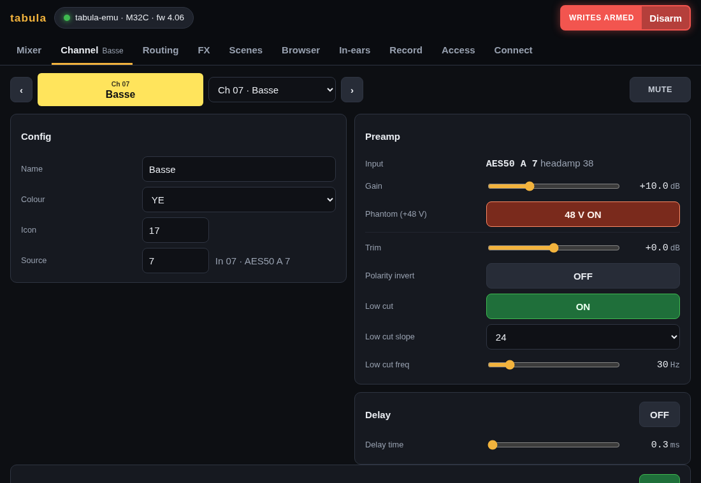

## Monitor

What the console's monitor and headphone outputs play, and the talkback
and the oscillator:

- **Solo**: the strips soloed, each a button that unsolos it, and **Clear
  solo**; *Exclusive* (one solo at a time), *Solo follows select*, *Select
  follows solo*, and PFL or AFL for inputs, buses and DCAs.
- **Monitor**: level, source (`LR`, `LR+C`, `LRPFL`, `LRAFL`, `AUX56`,
  `AUX78`), source trim, mono, dim and by how much, dim PFL, mute, delay.
- **Talkback** A and B: **TALK A** talks while held, as on the console
  (with *Latch* on, a press turns it on and the next one off); its level,
  whether it dims the monitor, and who it talks to (buses 1-16, LR, M/C).
- **Oscillator**: where the tone goes (a bus, L, R, L+R, M/C, a matrix),
  sine, pink or white noise, its level and two frequencies. **Start the
  tone…** says what goes where and asks first: sent to the main mix, the
  audience hears it. While it runs, the card says so.

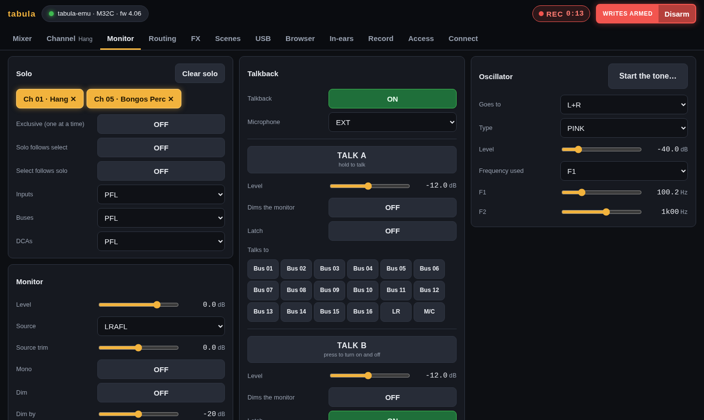

## Routing

Where the signals come from and where they go, in seven views.

### Patchbay

Every path a signal takes through the console, drawn in seven columns in
the order the signal goes through them:

- **Inputs**: the sockets a signal comes in by: the stage box inputs on
  AES50 A and B (`A 12`, with the gain of its preamp and `48V` when phantom
  power is on), the card's playback channels, the USB stick's player, the
  console's own inputs on the models that have them;
- **Channels**: the channels, aux inputs and FX returns fed by them;
- **Buses**, **Main** (LR and M/C) and **Matrices**, each fed by the columns
  before it;
- **Outputs**: the outputs 1-16 (with their delay), the aux, P16, AES/EBU and
  2-track outputs;
- **Goes out on**: the sockets a signal goes out by: the stage box outputs
  (`A 3 … out 3`), the card tracks a computer records (`REC` on those tabula
  records with the sessions) and the console's XLR outputs, each with what
  it carries.

A signal comes into a box on its left and leaves it on its right. The lines
are the routing (patches), the sends and assigns to the mixes (thinner;
only sends above −∞), a bus feeding an effect that comes back on its FX
return (dashed: the loop leaves the bus, runs under the columns and comes
up into the FX return), and the lines from a muted strip (dotted). Only
what is on a path shows: **Show unused** shows every socket and strip, and
AES50 channels 17-48 (a stage box plays channels 1-16 on its outputs).
The chips above choose the output ports shown; AES50 B shows by itself
when a stage box is there. A dot on a strip lights green while it has a
signal.

Point at anything (or tap it) to light up its paths, from the sockets
feeding it to the sockets it reaches; **Find** lights up the names and
sockets matching (`Theo`, `A 12`, `Track 17`). A tap opens the paths
spelled out at the bottom: where it comes from and where it goes, each step
with the send's tap and level (`PRE 0.0`) or the output's delay, a chip per
socket or strip to follow; Esc or ✕ closes it.

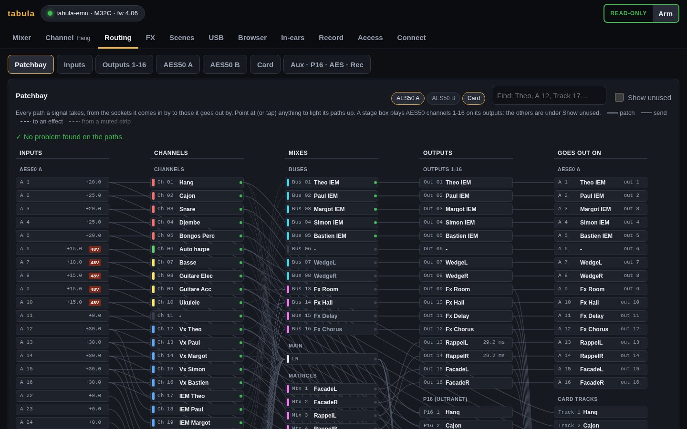

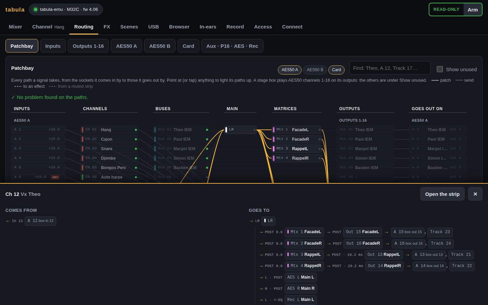

**Checks** under the title name what looks wrong:

- the console's inputs come from the playback routing (PLAY): the channels
  hear the card, not the stage;
- local inputs are routed on a model without them (an M32C has none);
- a card track recorded with the sessions carries nothing (an output
  without a source);
- phantom power is on for an input that feeds nothing;
- a bus or a matrix gets a signal but goes nowhere.

A check names a socket or a strip: click it to show its paths.

### The other views

- **Inputs**: the input routing of the 32 console inputs and the aux inputs,
  in blocks of 8, for live (REC) and playback (PLAY), with the console's
  REC/PLAY switch; then the input patch: for each input, where it comes from
  (`AES50 A 12`), its headamp gain and phantom, and the channels using it
  (`Ch 12 Vx Theo, Ch 17 IEM Theo`).
- **Outputs 1-16**: the console's outputs: source (with the bus, matrix or
  channel name), tap point, polarity, delay, and where each output goes
  (`AES50 A 1, Card 17…`).
- **AES50 A** and **AES50 B**: what the console sends on each AES50 port, in
  blocks of 8, then channel by channel what it finally carries
  (`Output 1 · MixBus 01 Theo IEM`). A stage box plays these channels on its
  outputs: on a DL32, output N is AES50 channel N (1-16), so the AES50 A view
  is the DL32's output patch.
- **Card**: what the console sends to the expansion card, track by track
  (`AES50 A 12 · Ch 12 Vx Theo`): what a computer records over USB.
- **Aux · P16 · AES · Rec**: the aux outputs, the P16 (Ultranet) outputs, the
  AES/EBU and 2-track recording outputs, the local XLR outputs (on consoles
  that have them) and the user routing (single-channel patches used by the
  UIN and UOUT blocks).

The patchbay only reads: the other views edit the routing. Blocks are edited
with the console's own names (`A1-8`, `OUT9-16`, `P161-8`…), with a plain
description beside them; output sources are listed with the names of their
strips.

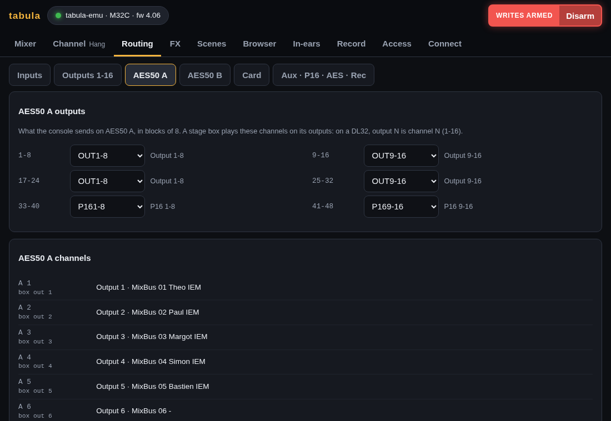

## FX

**All** shows the 8 effect slots: the effect loaded in each, and where it
is used. FX 1-4 fed from a bus say which (`Fed by Bus 13 Fx Room`) and the
FX returns they come back on; a slot inserted on a strip says which strips
(`Inserted on Mtx 1 Façade (L), Mtx 2 (R)`, from the console's `/-insert`).
The strip names link to their Channel page.

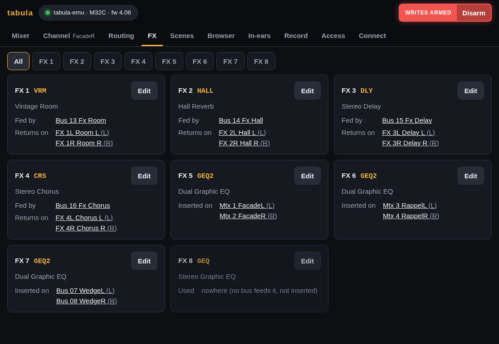

**FX 1 … FX 8** open one slot: its effect (loading another one asks for a
confirmation, as the new effect starts from its defaults), its sources for
FX 1-4, and its parameters with their names, ranges and units as the console
has them. Dual effects show their two sides side by side.

**Graphic EQs** (GEQ, GEQ2, TEQ, TEQ2) get a dedicated editor: 31 band
faders and the master level, side A or B for the dual ones, with the RTA
behind the bands. Drag a band up or down (Shift for fine moves, a touch
never makes it jump); the arrow keys pick a band and move it by 0.5 dB;
the selected band also has −, + and 0 dB buttons, and Flat resets every
band after a confirmation.

The RTA shows the input of the graphic EQ, before or after it. Choosing
the RTA source changes the console's state (`/-action/setrtasrc`), so it is
done only when writes are armed: opening the editor then points the RTA at
this EQ. Read-only, the editor shows the RTA of whatever source the console
has, and names it. The dB window follows the console's RTA settings
(`/-prefs/rta`: 30 dB under the RTA gain, or 60 dB).

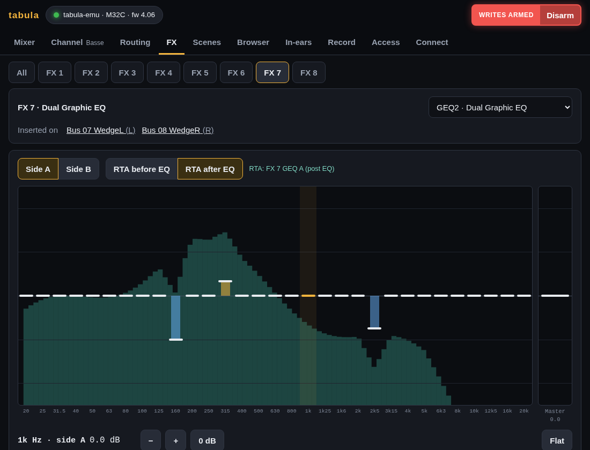

## Scenes

The console's library, in six tabs: scenes, snippets, channel presets,
effect presets, routing presets and AES50/DP48 presets; a seventh, **Scene
files**, holds the scene files of the machine running tabula (below). Each tab lists the
slots in use (tick *Empty slots* to see all 100), with their name and, for
scenes, their note; the scene or snippet the console's scenes page
highlights is marked *current* (when the console shows scenes or snippets
there).

- **Recall** a scene or snippet, or **load** a routing or AES50 preset, after
  a confirmation that says what changes.
- **Load…** a channel preset onto a strip, choosing the sections (headamp,
  configuration, gate, compressor, EQ, sends), or an effect preset into an FX
  slot.
- **Save** the current settings in a slot, with a name (and a note for
  scenes); a channel preset is saved from a strip, an effect preset from an
  FX slot. Saving over a used slot asks first.
- Open a slot (▾) to **rename**, **copy** it to another slot (not snippets:
  the console cannot) or **delete** it.

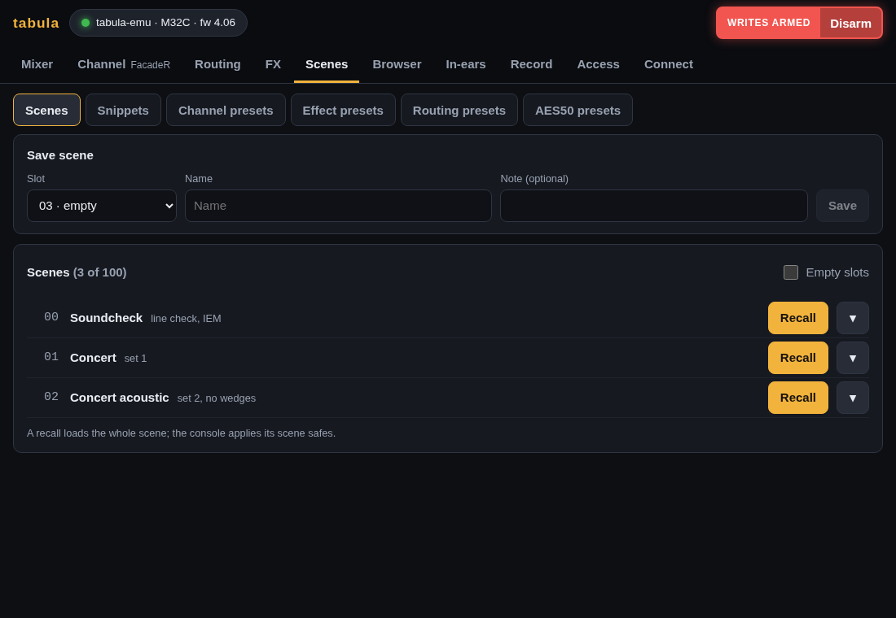

Every command changes the console, so the page needs armed writes. Recalls
apply the scene safes and snippet filters on a console; the emulator does
not apply them yet.

### Scene files

The `.scn` files kept in a folder of the machine running tabula
(`-scenes`, default `scenes` where tabula starts): a show prepared with
M32-Edit, saved by the console on a USB stick, or a backup of the console.

- **Open a file…** takes a scene file of the computer the browser runs on
  and keeps it in the folder (asking before replacing one of the same name).
- **Load** sends a file to the console, after a confirmation: every
  parameter it holds changes at once, as M32-Edit's PC → Mixer does, and the
  console's scene safes do not apply. A bar follows it (about 2,100 lines,
  a few seconds over Wi-Fi); lines the console does not know (a file from
  another model or firmware) are skipped and listed. It needs armed writes.
  Disarming while a file loads does not stop it halfway (half a scene is
  worse than either the old one or the new one): the button says
  *Disarms after the load*, the file is sent to its end, then writes
  disarm; click again to keep them armed.
  To keep the scene in the console's memory too, save it in a slot from the
  Scenes tab afterwards.
- **Save the console's settings as a file** writes the current settings as
  `<name>.scn`, which M32-Edit opens (reading needs no armed writes).
- ⤓ downloads a file, ✕ deletes it.
- **Backups**: before anything overwrites the console's settings (a scene
  file load, a replay, a recall of a scene, snippet, cue or preset, a file
  loaded from the USB stick, initialize, undo), tabula saves them as
  `Backup 2026-10-27 21.14.05.scn` in the same folder, listed apart, newest
  first. **Load** one to put the console back as it was. The newest 30 are
  kept (about 70 KB each); the same settings twice in a row are saved once.
  A backup that fails (a full disk) does not stop the load: the error shows
  here and in the log.

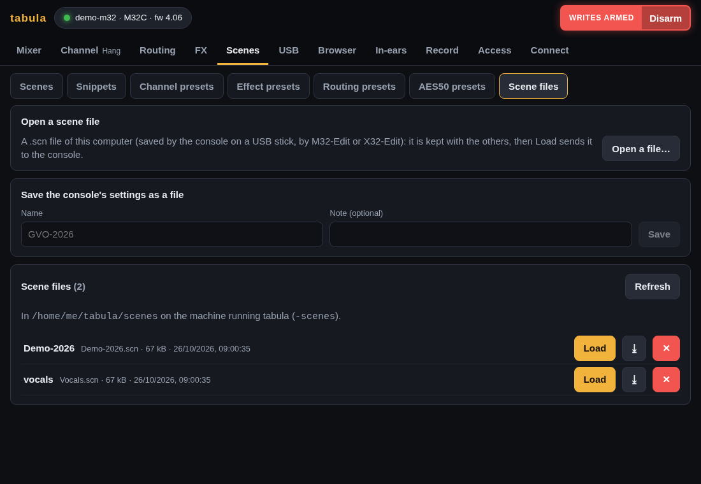

## USB

The USB stick in the console, as on its USB recorder screen. The **USB
player** shows the file loaded, whether it plays, its elapsed and remaining
time, with |◀ (previous file), ◀◀ (rewind), ▶ Play / ❚❚ Pause, ■ Stop,
▶▶ (fast forward), ▶| (next file), and *Then the next file of the folder*
(the console's folder mode). ◀◀ and ▶▶ stay lit while the player winds:
pressed again, the player goes back to playing (or to its pause); ▶ Play
plays from where it is. Below, the current folder of the stick: **Open** a
folder (or the parent folder), **▶ Play** a WAV file, **Load…** a scene,
snippet, preset (channel, effect, routing, AES50/DP48) or show file into
the console, after a confirmation saying what it changes (the console
loads it from the stick). The file in the player is marked. Every command needs armed writes; the sound
goes where the console's routing sends its USB player. While the console
records to its stick, ■ Stop asks first, and says whether it is the backup
of tabula's recording ([Record](#record)) or a recording started on the
console.

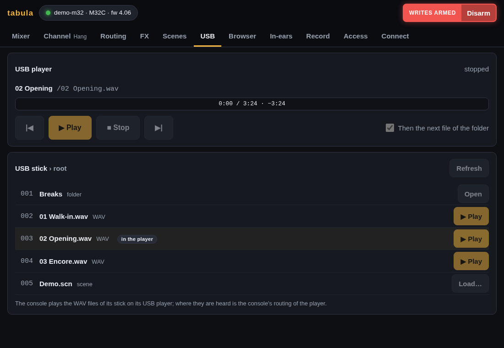

The emulator has a stick too, with `-usb dir` ([emulator](emulator.md#usb-stick)):
its WAV files play and wind silently, time running, and it loads the
scenes, snippets, presets and shows of the folder.

## Browser

Every parameter of the console as a tree of its OSC paths: `ch`, then
`01` (with the channel's name), then `config`, `eq`, `mix`…, then the EQ
bands or the sends. Each row shows the node's current values as the console
writes them, and opens into an editor of its fields and the nodes below it;
a value can also be typed as on the console (`-6`, `1k20`, `GATE`). The
branches you open are remembered.

The filter searches paths and values (`/ch/01/eq`, `Theo`, `GATE`): the tree
keeps only the matches and opens down to them, as far as a couple of
hundred rows; the counts tell where the other matches are.

Writes that can stop a show ask first, saying what happens: the clock
source and sample rate, the network settings (`/-prefs/ip`, set IP), the
card's settings (`/-prefs/card`: the DN32-USB restarts), initialize
(console, library, show), undo, formatting or deleting on the X-Live! card,
locking or shutting down the console (`/-stat/lock`), and recalls written
by hand (`/-action/goscene`…). The same editors ask on every page.

## In-ears

The in-ear mix of one bus as a musician sees it on their phone: a desk of
tall faders, one per source sending to the bus, with the bus volume on the
right. The engineer can open any
bus here; musicians get only theirs. See [access](access.md).

## Record

Record a show as a session, which keeps two things, as the page says above
**Start recording**:

- **Console**, always: the console's settings, not its sound. A snapshot of
  every setting when you start (a scene file that opens in M32-Edit), then
  every change, made on the console or here, with its time, and the markers
  you add (press M; holding it adds one).
- **Audio**, when **Audio tracks** is on: the sound of the console's USB
  card, one WAV file per track, in step with the console changes. Click
  the tracks to record in the list, named after what the console sends to
  each track of its card ([recording](recording.md#quick-start)); the page
  says how long the free space lasts with them. It warns when the device
  is not the console's card or not connected, and refuses to save more
  channels than the card has (32 channels from the laptop's 2-input card).
  When the audio settings were changed on the page and not saved, **Start
  recording** asks first: save them, discard them, or cancel, with what
  changed.
- **USB stick**, when **Backup on the console's USB stick** is on: the
  console's own recorder starts with the recording and writes a stereo WAV
  file to the console's stick, by itself: a backup that goes on if the
  laptop fails ([recording](recording.md#backup-on-the-consoles-usb-stick)).
  The card shows it recording, its time and file (`/R_20261026-203512.wav`),
  dropouts if the console reports some, and why it did not start (no stick,
  the player in use); the session details keep the file name.

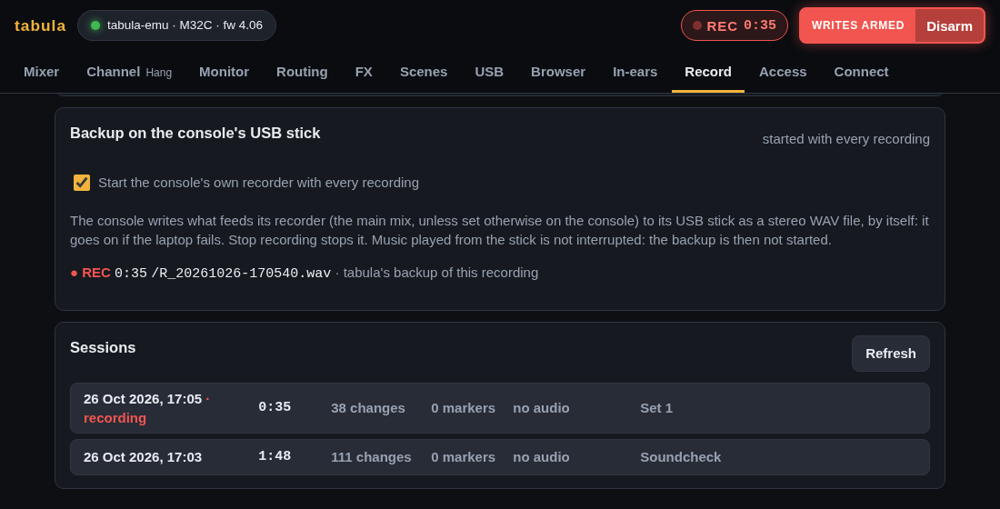

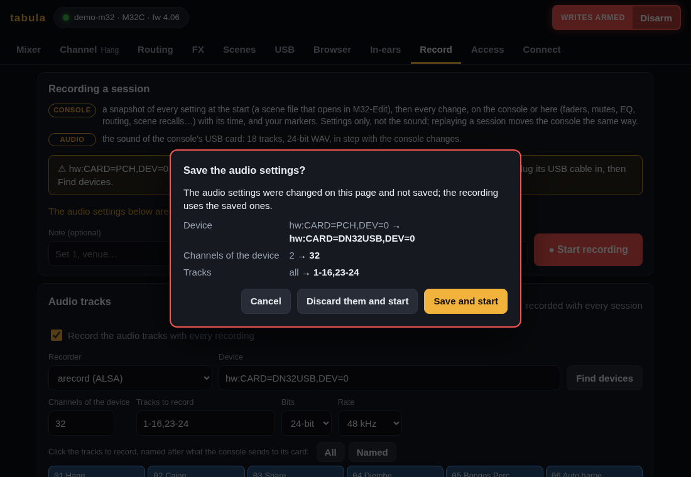

**Stop recording** asks first: the session and its audio end there.
Disconnecting, or connecting to another console, asks too while a recording
runs (see [Connect](#connect)).

When the audio of a recording fails, the top bar says *REC ⚠ NO AUDIO* and
a red bar under the pages says why, on every page; the Record page tells
what to do, and **Start the audio** starts it again in the same session
once the device is fixed ([recording](recording.md#when-the-audio-is-not-recorded)).

The session list says for each one how many console changes and markers it
holds, and whether it has audio. Replay a session onto the console or the
emulator, from a time or a marker, in real time (1×) or faster or slower
(0.5× to 8×; writes must be armed): it moves the console as recorded, each
change at its recorded time, and plays no sound. Export it for
Reaper or Audacity to listen to the audio with the markers. The details of
a session also show what it keeps of the console at the start, with
**⤓ Scene (.scn)** to open it in M32-Edit, and **Delete this session…**
removes it, audio included, after asking. When lines of its change log could
not be read (a recording cut short by a power cut), the details say how many
changes are missing, and where. See [recording](recording.md#replaying-a-session) and the
[API](API.md#recording-and-replay) for the session format.

## Access

Make access links (with QR codes) for musicians, viewers and other engineer
devices, and delete them to end that access. Set, change or remove the
engineer password, and sign out the devices signed in with it. Each link
and signed-in device says whether a page is open with it now (*Online*, with
the device's address) or when it was last seen, and the links count those
online: at the soundcheck, you see whose phone is on. See
[access](access.md#who-is-online).

## Connect

Find the consoles on the network (a broadcast that X32/M32 consoles and
`tabula-emu` answer) or type an address, connect and follow the sync. A
console that does not answer is asked again every few seconds (the page
says why) until it does; connecting to another address replaces it, so the
buttons stay usable meanwhile. While a recording runs, **Disconnect** and
every connect button ask first: they end the recording, with its audio.

**This tabula** says which version runs (`v0.2.0`; a build from a git
clone says its commit, `dev 9f91019`, with a `+` when it holds changes not
committed), since when (a tabula restarted during the show shows it), and
where it keeps its files: its log, the sessions, the scene files and the
access links. The version is also in the tooltip of the **tabula** logo, on
every page.

**Updated while a page is open.** A page left open on a phone while tabula
was updated (or restarted with another version) still runs the old GUI: a
bar asks to reload it, on the in-ear page too.
