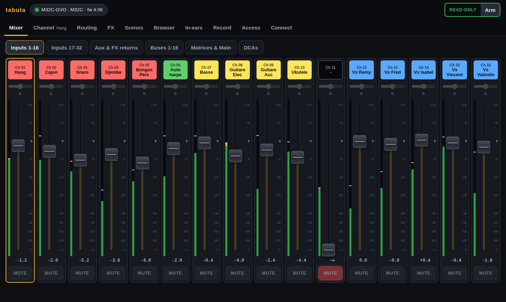

# The tabula GUI

`tabula` serves its GUI on its HTTP port (<http://localhost:8033> by
default; start it with `-http :8033` to reach it from a phone or a tablet).
Every page works on a phone as well as on a laptop. Any number of browsers
can be open at once: they share the one console connection, and a change
made in one shows in the others.

**Read-only until armed.** Controls are greyed out until you arm writes
(top right), after a confirmation. On a real console nothing moves by
accident. Disarm to go back to read-only.

**Who sees what.** The machine running `tabula` is the engineer and sees
every page (once signed in, when an engineer password is set). Other
devices get a role from an access link: viewers see the
Mixer, Channel and Browser pages read-only; musicians only get their in-ear
mix. Routing, FX, Scenes, USB, In-ears, Record, Access and Connect are
engineer pages. See [access](access.md).

## Mixer

Banks of strips, as on the console: inputs 1-16 and 17-32, aux inputs and
FX returns, buses, matrices and mains, DCAs. Each strip has its scribble
strip (name and colour), meter, fader, mute and pan. Tap a scribble strip to
select it for the Channel page. Names of two words take two lines
(`Guitare Elec`), so the 12 characters the console allows show in full.

On a phone, the banks scroll sideways:

**Linked pairs** (`/config/chlink`, `auxlink`, `fxlink`, `buslink`,
`mtxlink`) show as one stereo strip, `Mtx 1-2` or `FX 1`, with the meters of
both sides, when their faders and mutes follow each other (the link option
`/config/linkcfg/fdrmute`). Its fader and mute write to the odd strip, and
the console moves the even one with it, as it does for a linked pair on
its surface; pans stay per strip, on the Channel page. With the fader and
mute option off, the two strips stay separate. The Channel page of a linked
strip says which strip it is linked with.

## Channel

Everything about one strip: configuration, preamp and delay, the EQ with
its response curve, gate, dynamics, insert, main mix, sends with the bus
names, DCA and mute groups, automix. Only the sections the strip has are
shown. The EQ comes right after the preamp, so its curve is on screen when
the page opens; the other sections fill balanced columns.

**RTA.** When the console's RTA listens to the strip, its spectrum is
drawn behind the EQ curve. Two buttons under the curve point the RTA at this
strip, before or after its EQ (writes must be armed: it changes the console's
RTA source, `/-action/setrtasrc`).

**Headamp.** For a channel (or an aux input) fed by a preamp, the Preamp
section starts with that preamp: which input it is (`AES50 A 12`: input 12
of the stage box on AES50 A), its gain and its +48 V phantom power. The
console tells which headamp feeds each channel (`/-ha/NN/index`), following
the channel's source and the input routing; the gain and phantom are
`/headamp/NNN/gain` and `phantom`. Switching phantom power asks for a
confirmation, as it pops through the PA. When the input has no preamp
(card, user input, a bus…), the section says where it comes from instead.
The Source row of the Config section also shows the physical input
(`In 12 · AES50 A 12`).

## Routing

Where the signals come from and where they go, in six views:

- **Inputs**: the input routing of the 32 console inputs and the aux inputs,
  in blocks of 8, for live (REC) and playback (PLAY), with the console's
  REC/PLAY switch; then the input patch: for each input, where it comes from
  (`AES50 A 12`), its headamp gain and phantom, and the channels using it
  (`Ch 12 Vx Theo, Ch 17 IEM Theo`).
- **Outputs 1-16**: the console's outputs: source (with the bus, matrix or
  channel name), tap point, polarity, delay, and where each output goes
  (`AES50 A 1, Card 17…`).
- **AES50 A** and **AES50 B**: what the console sends on each AES50 port, in
  blocks of 8, then channel by channel what it finally carries
  (`Output 1 · MixBus 01 Theo IEM`). A stage box plays these channels on its
  outputs: on a DL32, output N is AES50 channel N (1-16), so the AES50 A view
  is the DL32's output patch.
- **Card**: what the console sends to the expansion card, track by track
  (`AES50 A 12 · Ch 12 Vx Theo`): what a computer records over USB.
- **Aux · P16 · AES · Rec**: the aux outputs, the P16 (Ultranet) outputs, the
  AES/EBU and 2-track recording outputs, the local XLR outputs (on consoles
  that have them) and the user routing (single-channel patches used by the
  UIN and UOUT blocks).

Blocks are edited with the console's own names (`A1-8`, `OUT9-16`, `P161-8`…),
with a plain description beside them; output sources are listed with the
names of their strips.

## FX

**All** shows the 8 effect slots: the effect loaded in each, and where it
is used. FX 1-4 fed from a bus say which (`Fed by Bus 13 Fx Room`) and the
FX returns they come back on; a slot inserted on a strip says which strips
(`Inserted on Mtx 1 Façade (L), Mtx 2 (R)`, from the console's `/-insert`).
The strip names link to their Channel page.

**FX 1 … FX 8** open one slot: its effect (loading another one asks for a
confirmation, as the new effect starts from its defaults), its sources for
FX 1-4, and its parameters with their names, ranges and units as the console
has them. Dual effects show their two sides side by side.

**Graphic EQs** (GEQ, GEQ2, TEQ, TEQ2) get a dedicated editor: 31 band
faders and the master level, side A or B for the dual ones, with the RTA
behind the bands. Drag a band up or down (Shift for fine moves, a touch
never makes it jump); the arrow keys pick a band and move it by 0.5 dB;
the selected band also has −, + and 0 dB buttons, and Flat resets every
band after a confirmation.

The RTA shows the input of the graphic EQ, before or after it. Choosing
the RTA source changes the console's state (`/-action/setrtasrc`), so it is
done only when writes are armed: opening the editor then points the RTA at
this EQ. Read-only, the editor shows the RTA of whatever source the console
has, and names it. The dB window follows the console's RTA settings
(`/-prefs/rta`: 30 dB under the RTA gain, or 60 dB).

## Scenes

The console's library, in six tabs: scenes, snippets, channel presets,
effect presets, routing presets and AES50/DP48 presets; a seventh, **Scene
files**, holds the scene files of the machine running tabula (below). Each tab lists the
slots in use (tick *Empty slots* to see all 100), with their name and, for
scenes, their note; the scene or snippet the console's scenes page
highlights is marked *current* (when the console shows scenes or snippets
there).

- **Recall** a scene or snippet, or **load** a routing or AES50 preset, after
  a confirmation that says what changes.
- **Load…** a channel preset onto a strip, choosing the sections (headamp,
  configuration, gate, compressor, EQ, sends), or an effect preset into an FX
  slot.
- **Save** the current settings in a slot, with a name (and a note for
  scenes); a channel preset is saved from a strip, an effect preset from an
  FX slot. Saving over a used slot asks first.
- Open a slot (▾) to **rename**, **copy** it to another slot (not snippets:
  the console cannot) or **delete** it.

Every command changes the console, so the page needs armed writes. Recalls
apply the scene safes and snippet filters on a console; the emulator does
not apply them yet.

### Scene files

The `.scn` files kept in a folder of the machine running tabula
(`-scenes`, default `scenes` where tabula starts): a show prepared with
M32-Edit, saved by the console on a USB stick, or a backup of the console.

- **Open a file…** takes a scene file of the computer the browser runs on
  and keeps it in the folder (asking before replacing one of the same name).
- **Load** sends a file to the console, after a confirmation: every
  parameter it holds changes at once, as M32-Edit's PC → Mixer does, and the
  console's scene safes do not apply. A bar follows it (about 2,100 lines,
  a few seconds over Wi-Fi); lines the console does not know (a file from
  another model or firmware) are skipped and listed. It needs armed writes.
  To keep the scene in the console's memory too, save it in a slot from the
  Scenes tab afterwards.
- **Save the console's settings as a file** writes the current settings as
  `<name>.scn`, which M32-Edit opens (reading needs no armed writes).
- ⤓ downloads a file, ✕ deletes it.

## USB

The USB stick in the console, as on its USB recorder screen. The **USB
player** shows the file loaded, whether it plays, its elapsed and remaining
time, with |◀ (previous file), ▶ Play / ❚❚ Pause, ■ Stop, ▶| (next file),
and *Then the next file of the folder* (the console's folder mode). Below,
the current folder of the stick: **Open** a folder (or the parent folder),
**▶ Play** a WAV file, **Load…** a scene, snippet or preset file into the
console (after a confirmation: the console loads it from the stick). The
file in the player is marked. Every command needs armed writes; the sound
goes where the console's routing sends its USB player.

The emulator has a stick too, with `-usb dir` ([emulator](emulator.md#usb-stick)):
its WAV files play silently, time running.

## Browser

Every parameter of the console as a tree of its OSC paths: `ch`, then
`01` (with the channel's name), then `config`, `eq`, `mix`…, then the EQ
bands or the sends. Each row shows the node's current values as the console
writes them, and opens into an editor of its fields and the nodes below it;
a value can also be typed as on the console (`-6`, `1k20`, `GATE`). The
branches you open are remembered.

The filter searches paths and values (`/ch/01/eq`, `Theo`, `GATE`): the tree
keeps only the matches and opens down to them, as far as a couple of
hundred rows; the counts tell where the other matches are.

## In-ears

The in-ear mix of one bus as a musician sees it on their phone: a desk of
tall faders, one per source sending to the bus, with the bus volume on the
right. The engineer can open any
bus here; musicians get only theirs. See [access](access.md).

## Record

Record a show as a session, which keeps two things, as the page says above
**Start recording**:

- **Console**, always: the console's settings, not its sound. A snapshot of
  every setting when you start (a scene file that opens in M32-Edit), then
  every change, made on the console or here, with its time, and the markers
  you add (press M).
- **Audio**, when **Audio tracks** is on: the sound of the console's USB
  card, one WAV file per track, in step with the console changes. Click
  the tracks to record in the list, named after what the console sends to
  each track of its card ([recording](recording.md#quick-start)); the page
  says how long the free space lasts with them. It warns when the device
  is not the console's card or not connected, and refuses to save more
  channels than the card has (32 channels from the laptop's 2-input card).
  When the audio settings were changed on the page and not saved, **Start
  recording** asks first: save them, discard them, or cancel, with what
  changed.

When the audio of a recording fails, the top bar says *REC ⚠ NO AUDIO* and
a red bar under the pages says why, on every page; the Record page tells
what to do, and **Start the audio** starts it again in the same session
once the device is fixed ([recording](recording.md#when-the-audio-is-not-recorded)).

The session list says for each one how many console changes and markers it
holds, and whether it has audio. Replay a session onto the console or the
emulator, from a time or a marker, in real time (1×) or faster or slower
(0.5× to 8×; writes must be armed): it moves the console as recorded, each
change at its recorded time, and plays no sound. Export it for
Reaper or Audacity to listen to the audio with the markers. The details of
a session also show what it keeps of the console at the start, with
**⤓ Scene (.scn)** to open it in M32-Edit, and **Delete this session…**
removes it, audio included, after asking. See [recording](recording.md#replaying-a-session) and the
[API](API.md#recording-and-replay) for the session format.

## Access

Make access links (with QR codes) for musicians, viewers and other engineer
devices, and delete them to end that access. Set, change or remove the
engineer password, and sign out the devices signed in with it. See
[access](access.md).

## Connect

Find the consoles on the network (a broadcast that X32/M32 consoles and
`tabula-emu` answer) or type an address, connect and follow the sync.
