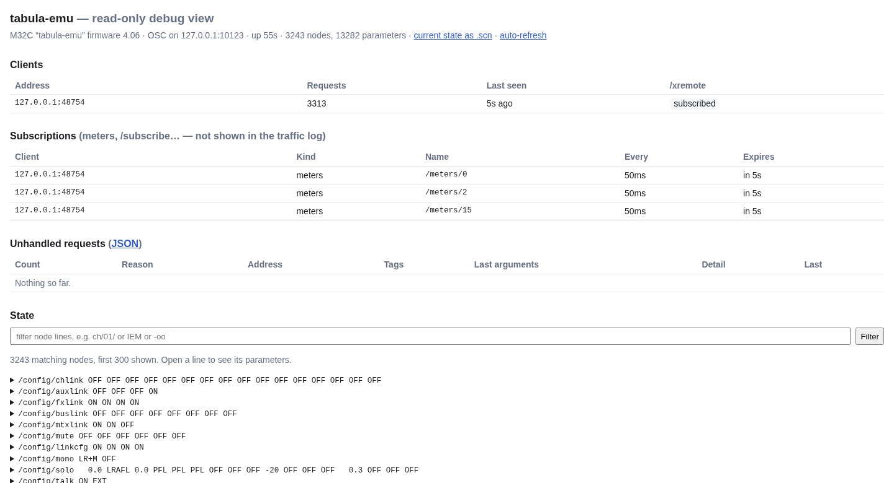

# tabula

Tools for **Behringer X32 / Midas M32** digital consoles, written in Go.

## Download

The latest build, made from the main branch each time its tests pass:

| System | Download |
|---|---|
| Linux, x86-64 | [tabula-linux-amd64.tar.gz](https://github.com/yoda-jm/tabula/releases/download/latest/tabula-linux-amd64.tar.gz) |
| Linux, ARM 64-bit (Raspberry Pi 3/4/5 with a 64-bit system) | [tabula-linux-arm64.tar.gz](https://github.com/yoda-jm/tabula/releases/download/latest/tabula-linux-arm64.tar.gz) |
| Linux, ARM 32-bit (Raspberry Pi 2 or later with a 32-bit system) | [tabula-linux-arm.tar.gz](https://github.com/yoda-jm/tabula/releases/download/latest/tabula-linux-arm.tar.gz) |
| macOS, Apple silicon | [tabula-darwin-arm64.tar.gz](https://github.com/yoda-jm/tabula/releases/download/latest/tabula-darwin-arm64.tar.gz) |
| macOS, Intel | [tabula-darwin-amd64.tar.gz](https://github.com/yoda-jm/tabula/releases/download/latest/tabula-darwin-amd64.tar.gz) |
| Windows, x86-64 | [tabula-windows-amd64.zip](https://github.com/yoda-jm/tabula/releases/download/latest/tabula-windows-amd64.zip) |

Each archive holds both programs, `tabula-emu` and `tabula`, with the web GUI
built in: unpack it and run them, nothing to install. Checksums:
[SHA256SUMS](https://github.com/yoda-jm/tabula/releases/download/latest/SHA256SUMS). On macOS, the binaries are not signed: allow
them once with `xattr -d com.apple.quarantine tabula tabula-emu`.

**Recording the audio tracks** (optional) needs a recorder program that is
not in the archives:

- Linux: `arecord`, from alsa-utils, already there on most systems.
- macOS: [ffmpeg](https://evermeet.cx/ffmpeg/), a static build: unzip
  `ffmpeg` next to `tabula` (allow it with
  `xattr -d com.apple.quarantine ffmpeg`), or `brew install ffmpeg`.
- Windows: [ffmpeg](https://www.gyan.dev/ffmpeg/builds/), the *release
  essentials* zip: put its `bin\ffmpeg.exe` next to `tabula.exe`, or
  `winget install Gyan.FFmpeg`.

Other builds are listed on [ffmpeg.org](https://ffmpeg.org/download.html).
tabula finds the program on the PATH or next to itself. Recording the
console's card through ffmpeg on macOS and Windows has not been tried yet:
test it before a show ([recording](recording.md#on-macos-and-windows)).

Versioned releases, with their notes, are on the
[releases page](https://github.com/yoda-jm/tabula/releases).

## tabula-emu — a console on your laptop

`tabula-emu` speaks the console's OSC protocol on UDP port 10023, so remote
apps — X32-Edit, M32-Edit, Mixing Station, the tabula client — can connect to
it as if it were a console. Use it to prepare a show offline, to develop and
test software, or to learn the console without one.

```sh
tabula-emu -scene my-show.scn -save my-show.scn -http :8032
```

- `-scene` loads a scene file at start, `-save` writes the state back on exit.
- `-http` opens a **read-only debug page**: every parameter (searchable), the
  connected clients, the traffic, and every request the emulator did not
  understand — connect an editor and see what is missing.
- `-unhandled-log file.jsonl` appends every unhandled request to a file.
- `-library dir` keeps the scenes, snippets and presets saved with `/save`
  (from an editor's library pages) in a directory, one file each
  (`scene-07.scn`, `snippet-03.snp`…). A scene file copied there as
  `scene-NN.scn` fills slot NN, ready to recall from an editor or from
  tabula's Scenes page.
- `-usb dir` puts a USB stick in the console: the folder stands for it, its
  WAV files play (time running, previous/next, folder mode, no sound) and its
  scenes load, as the console's USB recorder does
  ([details](emulator.md#usb-stick)); try `-usb testdata/usb`.
- `-model` picks what `/info` reports: X32, X32RACK, X32C, X32P, X32CORE, M32, M32R, M32C.



### What works today

- Every parameter of a scene file: configuration and routing, 32 channels,
  8 aux ins, 8 FX returns, 16 buses, 6 matrices, main LR and mono, 8 DCAs,
  FX slots with the parameters of all 61 effects, outputs, 128 headamps.
- `/info`, `/xinfo`, `/status`, get and set of every parameter (enums by
  name or index, floats quantized to the console's known values), node sets
  with multiple type tags, `/node`, `/` (echoed), and `/xremote`: changes
  are pushed to the other connected clients.
- Real scenes round-trip byte for byte, also when dumped over the network
  with Patrick-Gilles Maillot's `X32GetScene`.
- The scene, snippet and preset library: `/save`, `/load`, `/copy`,
  `/delete`, `/rename`, `/add`, `/showdump`.
- Preferences and status (`/-prefs`, `/-stat`, `/-show`, `/-libs`, `/-usb`,
  `/-urec`, `/-action`…), as the editors query them when connecting.
- Meters (`/meters/0…16`) with synthetic levels that follow the mix, and
  `/subscribe`, `/formatsubscribe`, `/batchsubscribe`, `/renew`, `/unsubscribe`.
- The RTA of the source an editor selects (a channel, a bus, a graphic EQ…),
  shaped by the low cut, the EQ and the graphic EQ.
- Linked channels, aux inputs, FX returns, buses and matrices kept in step
  as the console does, following the link options.
- The USB stick's player and file browser, from a folder (`-usb`).

**[How the emulator simulates the console](emulator.md)**: audio flow,
meters, RTA, effects, and exactly what linking two strips does.

### Not yet

Scene safes and snippet filters on recall: see the [plan](PLAN.md).

## tabula — the client

`tabula` connects to a console (or to `tabula-emu`) and serves a web GUI,
from the same binary, to any browser on the network — a laptop at the desk
or a phone on stage.

```sh
tabula -console 192.168.1.62 -http :8033
```


- **Mixer**: banks of strips (inputs, aux and FX returns, buses, matrices
  and mains, DCAs) with scribble strips in the console colours, meters,
  faders, mutes and pans; linked pairs show as one stereo strip.
- **Channel**: everything about one strip — config, preamp with the headamp
  feeding it (which input, gain, phantom power), gate, dynamics, EQ with its
  (approximate) response curve and the RTA, sends with the bus names.
- **Routing**: a patchbay drawing every path from the stage box inputs to the
  stage box outputs and the card tracks, to check at a glance where a
  signal goes; the input patch (which stage box input feeds which channel,
  with its headamp), the outputs and where each one goes, and what each
  output port carries — AES50 A and B (a DL32's outputs), the card's tracks,
  P16, aux, AES/EBU — with the names of the buses, matrices and channels.
- **FX**: the 8 effect slots and where each is used (fed by a bus,
  inserted on a strip), an editor per slot with the effect's parameters, and
  a graphic EQ editor with the RTA behind the bands; the RTA also shows
  behind a channel's EQ curve.
- **Scenes**: the scenes, snippets and presets the console holds; recall
  (after a confirmation), save, rename, copy and delete them, load channel
  presets onto a strip and effect presets into a slot. **Scene files**:
  `.scn` files kept on the laptop (a show prepared in M32-Edit), loaded into
  the console in one go, and the console saved as one.
- **USB**: the console's USB stick and player: browse its folders, play a
  WAV file (pause, stop, previous, next), load a scene from it.
- **Browser**: every parameter of the console as a tree of its paths
  (`ch` → `01` → `eq` → `1`), searchable by path or value, each with an
  editor; values can also be typed as on the console (`-6`,
  `1k20`, `GATE`).
- **Record**: record a show (snapshot plus every change, with markers) and
  replay it onto the console or the emulator. With the console's USB card,
  the audio tracks are recorded too, one WAV file each, in sync with the
  console moves, ready for Audacity or Reaper. See
  [recording a show](recording.md).
- **In-ear mixes for the band**: each musician scans a QR code and gets
  their own mix on their phone, and nothing else; viewers watch without
  touching. An optional engineer password protects full control, on the
  laptop too. See [access](access.md).
- **Connect**: find consoles on the network or type an address.

<p>


</p>

It is **read-only** until writes are armed, after a confirmation: on a real
console, nothing moves by accident. **[Every page of the GUI](gui.md)** in
detail. `-record` starts recording as soon as the console is synced (asking
it again until it answers, when the laptop starts first), for unattended
recording of a concert (`-audio-device hw:CARD=X32,DEV=0
-audio-tracks 1-16` adds the audio).

Later: more band-specific screens.

## Reference

The protocol work relies on Patrick-Gilles Maillot's *Unofficial X32/M32 OSC
Remote Protocol* and his tools: <https://sites.google.com/site/patrickmaillot/x32>.

Source code: <https://github.com/yoda-jm/tabula>
