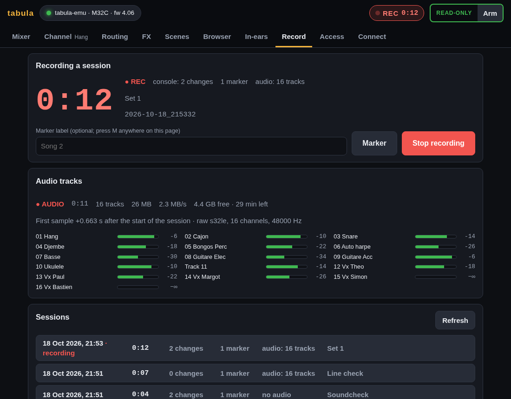
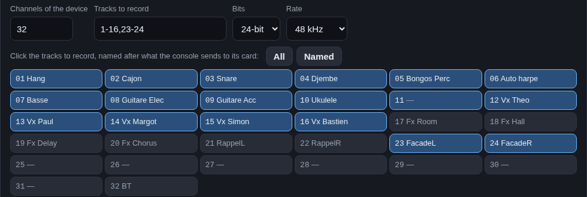
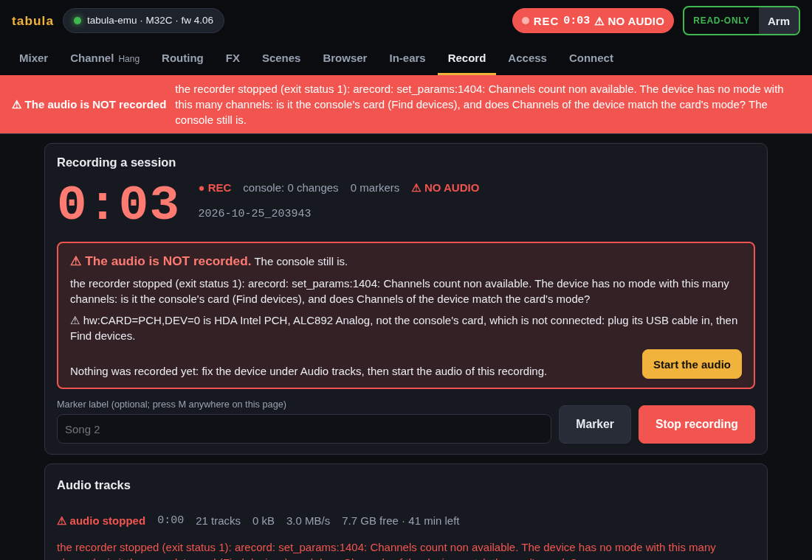
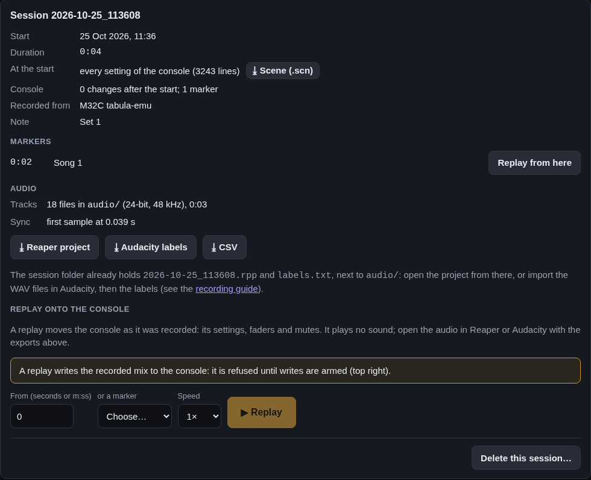
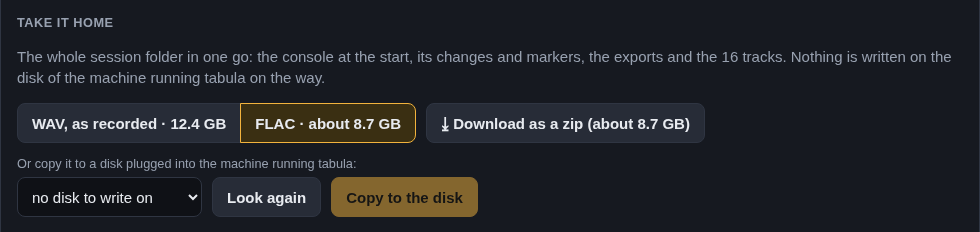

# Recording a show, with its audio

`tabula` records a show as a **session**, made of two parts:

- **The console** (always): its settings, not its sound. A snapshot of the
  console when the recording starts, every change made afterwards with its
  time (who moved which fader, when), and markers. tabula adds the markers
  *console lost* and *console back* when the console stops answering and
  when it answers again (synced again), and a change lost on the Wi-Fi and
  found again by reading the console back is kept with the origin
  `console, read back`, at the time it was found.
- **The audio** (when enabled): **one WAV file per track** of the console's
  USB card, recorded by the same program so that the tracks and the console
  moves line up.

Afterwards, open the tracks in Audacity or Reaper with the markers in
place, and replay the console moves onto the console or the emulator (a
replay moves faders and settings; it plays no sound).



## Quick start

Before a show, open the **Check** page: it lists what would spoil the
recording (the card's mode and sample rate against the audio settings, the
device, the disk space for the show's length, the power, sleep), each with
what to do ([the Check page](gui.md#check)).

On the **Record** page, in **Audio tracks**: tick *Record the audio tracks
with every recording*, choose the device (**Find devices** lists them; the
console's card is marked ★), the tracks, and **Save**. **Test the input**
listens for three seconds and shows the level of every track. From then
on, **Start recording** records the audio too, and **Stop recording** stops
both. A recording uses the saved settings: when some were changed on the
page and not saved, **Start recording** asks whether to save them or
discard them, showing what changed.

When the device chosen is not the console's card, or is not connected, the
page says so above **Start recording**, with a button to record from the
console's card when it is connected. If the audio fails anyway, every page
says it in red: see [when the audio is not recorded](#when-the-audio-is-not-recorded).

To record only the tracks you need, click them: the list names each track
of the card after what the console sends to it (*Setup › Routing › Card
Out*), **All** takes them all and **Named** only those with a name. The
clicks write the list in *Tracks to record* (`1-16,23-24`: the inputs
and a stereo board mix), which you can also type. The line below says
what those tracks take per hour, and how long the free space lasts with
them.



Unattended, from the command line:

```sh
tabula -console 192.168.1.62 -record -audio-device hw:CARD=X32,DEV=0 -audio-tracks 1-16,23-24
```

`-record` starts recording at once when the audio tracks are on, and the
console joins the session as soon as it is synced: a console that does not
answer yet (the laptop started first, the Wi-Fi not up) is asked again
every few seconds, while its audio is already recorded (the USB card does
not need the network). Without audio, the recording starts once the console
is synced. Ctrl-C stops the recording and finishes the files.

**Without the console.** With the audio tracks on, **Start recording**
works without a console connected (the Wi-Fi down at the start): the audio
is recorded alone (the top of the Record page says *console: not connected
yet*), and the console joins the same session once it is connected and
synced, with its snapshot of then, its changes from then on, and a
*console connected* marker. Disconnecting or connecting to a console does
not end such a recording; once the console has joined, Disconnect ends it,
as for any recording. The tracks are named *Track 01.wav*… when the console
was not there to name them. A session that never saw the console holds the
audio alone: it opens, exports and plays back (virtual soundcheck) like
any other, and a replay has no console moves to write. The settings saved from the GUI are kept
in `<sessions>/audio.json` and used by every later run; flags given on the
command line override them for that run.

## What a session holds

```
sessions/2026-10-17_203000/
  meta.json        what was recorded, from which console, when; the audio section
  start.scn        the console at the start (a scene file: opens in M32-Edit)
  start.nodes      the other parameters at the start (preferences, status)
  events.jsonl     every change and marker, with its time
  audio/           01 Hang.wav, 02 Cajon.wav, … Track 11.wav, …
  2026-10-17_203000.rpp   Reaper project (written when the recording stops)
  labels.txt       Audacity label track (idem)
```

The details of a session, on the Record page, show what it keeps of the
console at the start (*every setting of the console*, with the number of
lines of `start.scn` and `start.nodes`): **⤓ Scene (.scn)** downloads
`start.scn`, to open in M32-Edit or to start the emulator with
(`tabula-emu -scene`). A replay starts by setting the console back to it.
**Delete this session…** removes the session's folder, audio included,
after saying what it holds; not while it is being recorded or replayed.
The audio settings (`audio.json`) stay.

Each audio file is mono PCM, 24-bit by default (16 or 32 on request), at
the card's rate (48 kHz). Files are named after the track number of the
card and what feeds it on the console: `tabula` follows the card's routing
(*Setup › Routing › Card Out*, `/config/routing/CARD`) to the input, and the
input to the first channel using it as its source (`/ch/NN/config/source`),
whose name it takes. A card output fed by a console output takes the name
of the bus, matrix or main behind it. A track without a name is
`Track 11.wav`. *Name the files “Track 01”…* (`-audio-plain-names`) turns
this off, for a device that is not the console's card.

## Markers and the setlist

A marker is a moment of the show with a label: the start of a song, an
incident. While recording, **⚑** in the top bar (on every page of the
engineer) or the M key adds one; the markers are in the session's details,
and in its exports for Reaper (project markers), Audacity (labels) and
the CSV, at their place in the audio.

Type the **setlist** before the show, on the Record page, one song per line.
Then one tap on ⚑ (or M) marks the next song with its name, *3. Song
name*, and moves on to the one after it: after the show, every song is
found at once in the recording. A song played out of order is marked from
the menu (▾), and the setlist goes on from it; the menu also goes back one
song, skips one, or adds a marker with a label of yours (*Break*,
*Encore*). When every song is marked, ⚑ adds timed markers.

tabula keeps the setlist in `setlist.json`, in the sessions folder, with
the next song to mark: it is still there after a restart, and every
engineer device shows the same next song (two devices marking at the same
time never mark the same song twice). A session keeps the setlist it was
recorded with (`setlist.json` in its folder), and its details list the
songs with the time each was marked.

## Replaying a session

Every change in `events.jsonl` keeps its time, in seconds after the start
of the recording, to the nanosecond (`{"t":1.088332318,"addr":"/ch/01/mix/fader",…}`):
the moment `tabula` received it from the console, a few milliseconds after
it was made. Markers are timed the same way.

**Replay onto the console** (session details, on the Record page) first sets
the console as it was at the chosen time (the snapshot plus every change up
to then), then sends each later change at its recorded time: in real time at
**1×**, three times faster at **3×** (a fader move of 3 s takes 1 s), or at
0.5×, 2×, 4× or 8×. Times are counted from the start of the replay, not from
the previous change, so a long replay does not drift: the changes arrive
within about a millisecond of their time. Start from a time (`45`, `12:30`)
or pick a marker (*Replay from here*). The API takes any speed.

A replay moves the console; it plays no sound unless it is a virtual
soundcheck (below). To hear the show elsewhere, open the audio tracks with
the markers (below). Writes must be armed, since a replay writes to the
console.

## Virtual soundcheck

A session recorded with its audio can be played back **through the
console**: the tracks go back to the console's USB card, each on the card
channel it was recorded from, while the console moves as recorded. The
channels then hear the show as the band played it, and the show can be
mixed again, or a soundcheck rehearsed, without the band. tabula does no
mixing or editing of its own: the console mixes, as at the show.

In the session's details (Record page), tick **Virtual soundcheck: play the
recorded tracks to the console's card too**, choose where to start (a time
or a marker) and **▶ Start the soundcheck**:

- The console's inputs must hear the card. On the X32/M32 the inputs come
  from the stage (routing *REC*) or from the playback routing (*PLAY*),
  which takes the card from the factory (*1-8 ← CARD1-8*…; Routing page).
  With **Switch the console's inputs to the card** (ticked by default),
  tabula switches to *PLAY* for the time of the soundcheck and back as it
  was at the end, or on **Stop** (even if writes were disarmed meanwhile:
  the stage must be heard again). The page says which inputs the PLAY
  routing takes from the card, and warns when none. The replay leaves this
  switch alone: the session's own *REC* is neither restored nor replayed.
- It plays at 1× only (the tracks are not sped up), from the chosen time;
  before the first sample of the audio, silence plays. The tracks start
  once the console holds the state of that time, with the first timed
  change; they play to their end, after the last change, unless stopped.
- tabula saves the console's settings first, as before every replay (a
  backup in the scene files).
- Not during a recording: stop it first. Nor during a test of the input.

The tracks are streamed to a player program, as raw 32-bit samples with the
session's channels and rate, read from the WAV files as they play: nothing
is written to the disk. The player matches the recorder:

| Recorder | Player |
|---|---|
| arecord | `aplay -D {device} -c {channels} -r {rate} -f S32_LE -t raw --buffer-time=200000 --period-time=10000 -` |
| parecord | `pacat --playback --raw --format=s32le --rate={rate} --channels={channels} --no-remix --no-remap --latency-msec=50 -d {device}` |
| ffmpeg (Linux) | `ffmpeg … -f s32le -ar {rate} -ac {channels} -i - -f alsa {device}` |
| ffmpeg (macOS) | `ffmpeg … -f s32le -ar {rate} -ac {channels} -i - -f audiotoolbox -audio_device_index {device} -` (not tried) |

The device is the one recorded from (an ALSA device plays and records; for
PipeWire/PulseAudio, the card's output matching the source recorded,
`alsa_output.…` for `alsa_input.…`), unless *Play the tracks to* in the
audio settings says another. On Windows, or with a custom recorder, set
*Command to play them*: it reads the raw samples on its standard input,
with `{device}`, `{channels}` and `{rate}` replaced; like a custom recorder,
only the machine running tabula chooses it.

The tracks and the console moves start together, within the player's
buffer (a fifth of a second with aplay). The card plays at its own clock,
as when it recorded, so they stay in step over a whole show. Not tried yet
with the DN32-USB: check the routing and a few seconds of sound before
relying on it.

## Setting up on Linux

The console's USB card (DN32-USB in a Midas M32, X-USB in a Behringer X32)
is a class-compliant USB audio device: no driver to install. Connect it,
then list the capture devices:

```sh
tabula -audio-list
```

```
RECORDER  DEVICE              CHANNELS  FORMAT           NAME
arecord   hw:CARD=PCH,DEV=0                               HDA Intel PCH, ALC892 Analog
arecord   hw:CARD=XUSB,DEV=0  32        S32_LE, 24 bits  X-USB, USB Audio  <- console card?
```

(an example with an X32's card; PipeWire or PulseAudio sources follow, for
parecord. `arecord -l` lists the same ALSA cards; for a USB card,
`/proc/asound/cardN/stream0` shows its channels, sample format and rates.)
The card sends 24-bit samples in 32-bit words (`S32_LE`), which `tabula`
records as such. The number of channels the computer sees follows the
card's USB mode on the console (*Setup › Card*: 32/32, 16/16…): set
**Channels of the device** (`-audio-channels`) to what the list shows, and
the rate (`-audio-rate`) to the console's (48 kHz unless the console runs at
44.1 kHz). Picking a device in **Find devices** sets its channels; for a card
that `/proc` does not describe (the laptop's own HDA card), tabula asks
`arecord --dump-hw-params`, which opens it for an instant and records
nothing. **Save** refuses more channels than the card has.

**arecord** (the default on Linux) needs the card for itself. With PipeWire
or PulseAudio running, it may answer *Device or resource busy*. Either:

- turn the card's profile **Off** while recording (pavucontrol ›
  Configuration, or `pactl set-card-profile <card> off`; `pactl list cards
  short` names the card): arecord then opens it directly — the most precise
  timing; or
- set the card's profile to **Pro Audio** and record through PipeWire with
  **parecord**: recorder *parecord (PulseAudio, PipeWire)* and the source
  ending in `pro-input-0` (`-audio-recorder parecord -audio-device
  alsa_input.usb-…pro-input-0`).

If arecord answers *Sample format non available* or *Channels count non
available*, check the device (the laptop's own card, `PCH`, has two
channels) and the channel count; `plughw:CARD=…` instead of `hw:` lets ALSA
convert the format. A Midas DN32-USB shows as `hw:CARD=DN32USB,DEV=0`.

## Disk space

What the files take, at 48 kHz:

| Tracks | 24-bit, per hour | two sets of 45 min, 24-bit | 16-bit, per hour |
|---|---|---|---|
| 8 | 4.1 GB | 6.2 GB | 2.8 GB |
| 16 | 8.3 GB | 12.4 GB | 5.5 GB |
| 32 | 16.6 GB | 24.9 GB | 11.1 GB |

The Record page shows the free space where sessions are kept and how much
audio it holds at the chosen settings; while recording, the space left and
the time left. Below 20 minutes left, a warning shows on the Record page,
next to REC in the top bar and in an amber bar under the pages. When only a minute of audio (256 MB at least)
is left, the audio stops by itself, cleanly: every file ends at the same
sample with a correct header, and the session (changes, markers) goes on.

If `tabula` or the laptop dies during the show, the files are still
readable: their headers are refreshed every two seconds, so at most the last
two seconds are missing (Audacity and Reaper read what is there). A file
past 4 GiB (a single 24-bit track gets there after 8 hours) turns into
RF64, which Audacity, Reaper and Ardour read.

## When the audio is not recorded

The audio and the console are recorded side by side: when the audio
fails, the recording of the console goes on, and `tabula` makes the failure
hard to miss.

- **Before recording**, the Record page checks the device saved (on Linux):
  it is not connected, it is not the console's card (`hw:CARD=PCH,DEV=0`,
  the laptop's own card, or `default`, the system's input), or it delivers
  another number of channels than *Channels of the device*. **Record from
  DN32-USB (…)** switches to the console's card when it is connected. A
  device other than the card on purpose (a test at home with the laptop's
  microphone)? Tick *Name the files “Track 01”…* and only a missing device
  is reported.
- **Saving** refuses more channels than the card has: 32 channels from the
  laptop's 2-input card is said at once, under *Channels of the device*,
  with the console's card to choose instead when it is connected.
- **Start recording** waits for **Test the input** to end when it runs (the
  card can only be opened once: the recording would find it busy and go on
  without its audio), and for a recording ended by a disconnect to finish
  its files.
- **Start recording** asks first when the audio settings were changed on the
  page and not saved: **Save and start** (a device picked in **Find
  devices** is then the one recorded), **Discard them and start** (the
  saved ones), or **Cancel**; it lists what changed. It answers once the
  audio runs or has failed (three seconds at most). *Start the audio* and
  *Stop and record again* ask the same.
- **When the audio fails**, the top bar says *REC ⚠ NO AUDIO*, a red bar
  under the pages says why on every page (*The audio is NOT recorded…
  The console still is.*), and the Record page shows the error with what
  to do. The usual recorder errors come with a hint: *Channels count non
  available* (not the console's card, or another channel count), *Device or
  resource busy* (PipeWire holds the card, see
  [Setting up on Linux](#setting-up-on-linux)), a card that is not there.
  Warnings (not the console's card, no audio for a few seconds, the disk
  almost full) show in an amber bar.
- **Start the audio again** without stopping: when the audio failed before
  recording anything, the Audio tracks card shows the settings during the
  recording; fix the device (**Find devices**, or the button for the
  console's card), **Test the input**, then **Start the audio**. The audio
  goes into the same session (its empty files replaced); its first sample
  is timed from the start of the session as always, so the tracks still line
  up with the console changes.
- **When the audio stops in the middle of the show** (a USB cable knocked
  out, the console rebooted, the card gone), tabula starts the recorder
  again by itself, as long as it takes (after 1 s, then 2, 4… up to every
  10 s), in the **same session and the same files**: silence stands for the
  time without audio, so the tracks stay in step with the console moves and
  with each other. Meanwhile the top bar says *REC ⚠ AUDIO LOST* and the red
  bar *The audio stopped…*; the session gets the markers *audio lost (why)*
  and *audio back after 4.2 s*, and its details list the gaps. A recorder
  that hangs instead of stopping (no audio for 5 s) is stopped and started
  again the same way. Nothing needs Stop and record again any more.
- **Every track silent** for 30 seconds while recording (below -80 dBFS:
  the console sends nothing to its card, its routing changed) is an alarm
  too: *REC ⚠ SILENT* and a red bar on every page, gone as soon as one
  track has signal again.



This came from a real show: the device saved during tests at home was the
laptop's own card. On stage, the console's card was picked in **Find
devices** but not saved, so the recording used the laptop's card and its
audio failed at once (*Channels count non available*). The failure only
showed as a ⚠ next to REC and further down the page, and the show was
recorded without its audio.

## When the console's changes are not recorded

The console's changes go to `events.jsonl` as they come, through a queue:
a disk that hangs rather than fails (a dying USB disk, a network share)
never holds up the live view or the phones. When changes wait for the disk
more than 2 seconds, the Record page says how many (*The disk is slow…*);
they are written once it takes them. If it takes nothing for minutes (the
queue holds minutes of a busy show), the next changes are lost and counted,
as below. If that file cannot
be written (a full disk, a USB disk pulled out), the Record page says so
while recording (*the console's changes cannot be written…*) and `tabula`
logs an error: the changes after it are lost, the audio goes on. A session
whose `events.jsonl` has lines that do not read (the last line of a
recording cut short by a power cut, a damaged file) still opens without
them: `tabula` logs an error naming the lines, and `GET
/api/sessions/{name}` lists them (`damaged`).

## Disconnecting during a recording

**Disconnect**, or connecting to another console, ends the recording, with
its audio: the session is finished in the background (the files take a
few seconds) and the next recording waits for it. A console lost on the
way (Wi-Fi) does not end it: `tabula` connects again by itself and the
recording goes on.

## Backup on the console's USB stick

With **Backup on the console's USB stick** on (the Record page, kept in
`audio.json` as `usb_backup`), **Start recording** also starts the
console's own recorder (`/-stat/tape/state` RECORD). The console writes a
stereo WAV file of what feeds its recorder to its USB stick: the main mix,
unless the console's *Setup › Routing* sends its recorder something else
(`/outputs/rec/01-02/src`). It does it by itself, so this backup goes on if
the laptop crashes or its card drops out. **Stop recording** stops it; so
do Disconnect and stopping `tabula`. Turned on during a recording, it
starts at once.

- The console names the file after the time (`R_20261026-203512.wav` on
  the X32); the Record page shows it while it records, and the session's
  `meta.json` keeps it (`usb_backup`), with the session details.
- No stick in the console: the recording goes on without the backup, and
  the page says why.
- **Walk-in music** played from the stick is not interrupted: the console's
  recorder cannot play and record at once, so the backup is not started
  while the player plays or is paused. Start it on the console's recorder
  screen once the music is over.
- A recording started on the console already is left as it is: Stop
  recording does not stop it.
- The console counts dropouts while it records (a stick too slow): the
  page shows them.
- The console starts recording even when writes are not armed: the
  setting asked for it.

This backup is untested on the real M32 so far; `tabula-emu` records
nothing, but names the file and counts its time.

## How the tracks line up with the session

Session times count from the start of the recording; the audio starts a
fraction of a second later (the time to start the recorder). `meta.json`
keeps when the first sample was captured, in seconds after the start of the
session (`offset`), and the exports use it.

That time is measured, not guessed: each block of samples arrives a little
after it was captured (the recorder's buffers, the pipe, the scheduler).
`tabula` notes when each block arrives and how many samples came before
it; arrival time minus samples received / rate is the capture start plus
that block's delay, and the smallest of these over the first ten seconds is
the best estimate. What remains is the delay no block avoids — the USB
transfer and the driver, a few milliseconds. The changes of the session are
timed when the console reports them over the network, within a few
milliseconds too. **Expect the tracks and the console moves to line up
within about 10 ms**: much finer than a fader move.

Over a long set, the console's audio clock and the computer's clock drift
apart by a few tens of parts per million (20 ppm: 54 ms over 45 minutes).
`tabula` measures it the same way, over the whole recording, keeps it in
`meta.json` (`drift_ppm`) and the exports correct the markers for it. It is
measured once a minute of audio is recorded.

When the recorder loses samples (an *overrun*: the computer was too busy to
read the card in time), the tracks lag behind the session from then on by
the lost time. The Record page warns about it, `meta.json` counts them
(`overruns`) and the drift is not applied. Overruns are rare with
`tabula`'s settings (half a second of buffer in arecord, several seconds
more in `tabula` before the disk); a busy laptop on battery saver is the
usual cause.

The audio section of `meta.json`:

```json
"audio": {
  "rate": 48000, "bits": 24, "channels": 32,
  "tracks": [{"channel": 1, "name": "Hang", "file": "audio/01 Hang.wav"}, …],
  "offset": 0.412308, "start": "2026-10-17T20:30:00.412308+02:00",
  "drift_ppm": 18.4, "frames": 129600000,
  "device": "hw:CARD=XUSB,DEV=0", "command": "arecord -D hw:CARD=XUSB,DEV=0 -c 32 …",
  "error": "…"
}
```

A change at session time *t* is at (*t* − `offset`) / (1 + `drift_ppm`·10⁻⁶)
seconds in the files.

## Opening a session in an audio editor

When a recording with audio stops, the session folder gets a Reaper project
and an Audacity label track. Each session in the list of the Record page
also offers them as downloads, with a CSV of every change and marker:



### Audacity

1. *File › Import › Audio…*, select every file of the session's `audio/`
   folder: one track each, all starting at 0.
2. *File › Import › Labels…*, choose `labels.txt` (from the session folder,
   or downloaded with **Audacity labels**): the markers appear as a label
   track, at their place in the audio.

### Reaper

Open `<session>.rpp` from the session folder (*File › Open project*): one
track per file, placed where its first sample falls on the session's
timeline, and the markers as project markers. A project downloaded with
**Reaper project** refers to `audio/…`: save it in the session folder,
next to `audio/`.

### Ardour and others

Import the files as new tracks at the session start; the markers are in
`labels.txt` (times in the files) and in the CSV.

### The CSV

`time` (session seconds), `audio_time` (seconds in the files), `clock` (date
and time), `type` (`change` or `marker`), `address`, `text` (the value as
the console writes it), `value` (raw), `origin` (`console`, `console, read back`
for a change lost on the network and found again, `local`, or `web <name>`
for an access link), `label` (markers).

## Taking a show home

After a show, a session is a folder of large WAV files on the stage laptop
(16.6 GB an hour for 32 tracks). In its details on the Record page, **Take
it home** sends the whole folder in one go: the console at the start, its
changes and markers, the exports and the tracks. Nothing is written on the
laptop's disk on the way, whatever the size: its free space stays for the
next show.



**WAV, as recorded**, or **FLAC**: lossless, about half the size. The
tracks are converted by ffmpeg while they are sent or copied (the `ffmpeg`
package on Linux; on macOS and Windows the ffmpeg tabula records with,
see [below](#on-macos-and-windows)). Live tracks shrink to 50–65 %, silent
ones to almost nothing; the page gives an estimate (70 %). 32-bit tracks
become 24-bit FLAC files: the console's card sends 24-bit audio. The FLAC
files say their length, but carry no MD5 checksum (they are written as they
are made; the zip's own checksums cover the transfer). The Reaper project
of a FLAC copy points at the FLAC files; keep the WAV version to put a
session back into a sessions folder.

**⤓ Download as a zip**: one zip of the folder (`2026-10-25_203512/…`,
or `2026-10-25_203512 FLAC/…`), made while it downloads. The device
downloading it needs the room. The tracks are stored as they are (audio
does not compress), the other files compressed; the small files come
first, so a download cut short still holds the console's part. Over Wi-Fi,
a show of 25 GB takes a while: a USB disk on the laptop is faster.

**Copy to a disk plugged into the machine running tabula** (a USB disk or
stick on the stage laptop): choose the disk, **Copy**. The list has the
disks mounted under `/media`, `/run/media` or `/mnt` on Linux (where
desktops mount USB disks), in `/Volumes` on macOS, the other drives on
Windows; not the one holding the sessions. A read-only disk shows, but
cannot be chosen. tabula checks first that the disk has room for the
session (or the FLAC estimate) plus 16 MB, and refuses if not, saying what
it takes and what is free. The session goes into `tabula/2026-10-25_203512`
on the disk (`… FLAC` for FLAC), first into a folder named
`2026-10-25_203512 (copying)`, renamed once every file is there: a copy cut
short (the disk unplugged, the laptop stopped) never looks complete.
**Cancel**, a failure or a full disk remove what was copied. Each file is
flushed to the disk before the next, and keeps its date; eject the disk
before unplugging it. One copy at a time; a session already on the disk is
not copied again (delete it there first). A FAT32 stick takes files up to
4 GB: format a large disk as exFAT.

The session being recorded cannot be taken home: its files are complete
once the recording stops. Another session can, during a recording, but
copying or downloading reads the disk the show is recorded on: the page
says so. Better once the show is over.

## Command-line flags

| Flag | Default | |
|---|---|---|
| `-audio` | off | record the audio with every session; any `-audio-…` flag implies it, `-audio=false` turns it off for this run |
| `-audio-device` | recorder's default | `hw:CARD=X32,DEV=0` (arecord), a source (parecord), a device (ffmpeg) |
| `-audio-channels` | 32 | channels the device delivers |
| `-audio-tracks` | all | channels to record: `1-16`, `1-8,12` |
| `-audio-bits` | 24 | 16, 24 or 32 bits per sample in the files |
| `-audio-rate` | 48000 | sample rate |
| `-audio-recorder` | arecord (Linux), ffmpeg | arecord, parecord, ffmpeg or custom |
| `-audio-cmd` | | a recorder command line (implies custom), see below |
| `-audio-input` | s32le | sample format of a custom command's raw output: s16le, s24le, s24-32le, s32le, f32le |
| `-audio-plain-names` | off | name the files `Track 01.wav`… |
| `-audio-list` | | list the capture devices and exit |

## Recorders and custom commands

`tabula` runs an external recorder and reads the samples from its output,
so nothing is needed at build time and the same binary runs everywhere:

| Recorder | Command |
|---|---|
| arecord | `arecord -D {device} -c {channels} -r {rate} -f S32_LE -t raw --buffer-time=500000 --period-time=10000` |
| parecord | `parecord --raw --format=s32le --rate={rate} --channels={channels} --no-remix --no-remap --latency-msec=20 -d {device}` |
| ffmpeg (Linux) | `ffmpeg … -f alsa -channels {channels} -sample_rate {rate} -i {device} -c:a pcm_s32le -f wav -` |
| ffmpeg (macOS) | `ffmpeg … -f avfoundation -i :{device} -c:a pcm_s32le -f wav -` (device: the number `-audio-list` shows) |
| ffmpeg (Windows) | `ffmpeg … -f dshow -channels {channels} -sample_rate {rate} -i audio={device} -c:a pcm_s32le -f wav -` |

A custom command (`-audio-cmd`, or *Custom command* in the GUI) is split
into arguments like a shell would (quotes group, nothing is expanded), with
`{device}`, `{channels}` and `{rate}` replaced. It writes the samples on its
standard output, interleaved: raw in the `-audio-input` format, or a WAV
stream, whose header `tabula` reads and checks (channels, rate). arecord
writes raw samples on purpose: its WAV output to a pipe ends after 2 GiB.

A custom command runs a program on the machine running `tabula`, so only
that machine chooses one (the flag, or the GUI opened on it): an
[engineer link](access.md) can change the device, tracks and format, and
keep the current command, but not set a new one.

## On macOS and Windows

ffmpeg records the card there; it is not in tabula's archives (see
[Download](index.md#download) for where to get it). tabula finds it on the
PATH, or next to its own program: on Windows, `ffmpeg.exe` in the folder of
`tabula.exe` is enough. If it is missing, the audio fails at once and the
red bar says how to install it.

These two systems have not been tried with the console's card yet: on
Windows, the card's ASIO driver is not usable by ffmpeg, and its WDM inputs
may offer fewer channels. **Test the input** before a show. The checks of
the device (the console's card, its channels) are made on Linux only; on
these systems, only a failure of the recorder is told.

## API

See [the API](API.md#audio): the audio settings, the devices, a test of the
input, the exports and taking a show home
([API](API.md#taking-a-show-home)) are engineer-only; the capture's state rides on the
record status, and so does the backup on the console's stick (`usb`, set
with `POST /api/record/usb`). A virtual soundcheck is a replay with `"audio":
true` ([API](API.md#recording-and-replay)).
